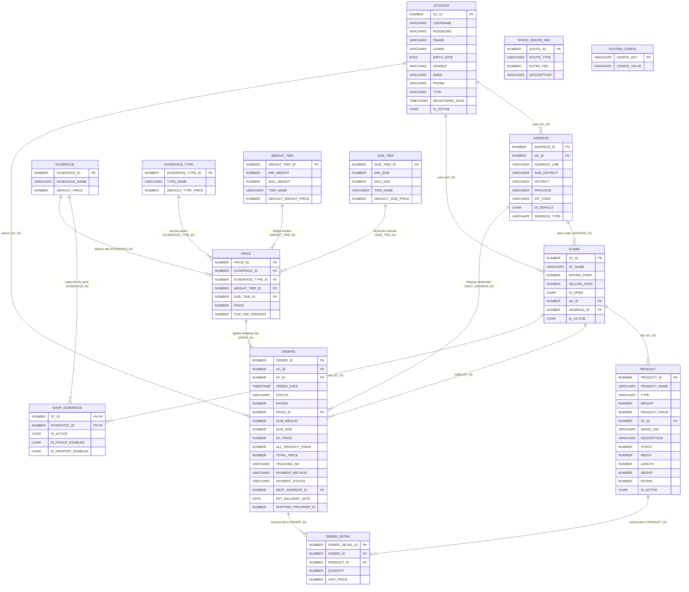

# 🛒 Online Medium Platform — MIXIAO STORE (CPE-303 Project)

<div align="center">

[](./README.md)
[-2563eb?style=for-the-badge>)](./README.en.md)


**🌐 Switch Language: [🇹🇭 อ่านเวอร์ชันภาษาไทย (`README.md`)](./README.md) | 🇬🇧 English (Current)**

</div>

A comprehensive **Full-Stack E-Commerce & Multi-Vendor Marketplace Platform** supporting a **Multi-Role Ecosystem** (`Customer`, `Seller`, `Employee`, and `Admin`). Built with an **Oracle 21c** relational database, **Node.js + Express 5** backend, and a modern **React 19** frontend featuring a **Two-Tier Apple Liquid Glass UI Architecture (WebGL Fragment Shader + SVG Displacement Refraction + GPU Ambient Light Mesh)**, multi-dimensional shipping fee calculation, partial cart checkout with automatic order splitting, and real-time delivery simulation.

---

## 📑 Table of Contents

1. [Project Overview & Role Capabilities](#-1-project-overview--role-capabilities)
2. [Architecture & Project Structure](#-2-architecture--project-structure)
3. [Part 1: Database Layer (Oracle 21c)](#-3-part-1-database-layer-oracle-21c)
   - [Entity-Relationship Diagram (ER Diagram)](#31-entity-relationship-diagram-er-diagram)
   - [Complete 13-Table Database Schema](#32-complete-13-table-database-schema)
   - [Database Design & Engineering Techniques](#33-database-design--engineering-techniques)
4. [Part 2: Backend Layer (Node.js & Express 5)](#-4-part-2-backend-layer-nodejs--express-5)
   - [Backend Stack & Configuration](#41-backend-stack--configuration)
   - [Complete RESTful API Reference](#42-complete-restful-api-reference)
   - [Backend Algorithms & Engineering Techniques](#43-backend-algorithms--engineering-techniques)
5. [Part 3: Frontend Layer (React 19)](#-5-part-3-frontend-layer-react-19)
   - [Pages & Core Components](#51-pages--core-components)
   - [Advanced Frontend Techniques](#52-advanced-frontend-techniques)
6. [Installation & Setup Guide](#-6-installation--setup-guide)

---

## 🌟 1. Project Overview & Role Capabilities

**Online Medium Platform (MIXIAO STORE)** serves as an end-to-end marketplace connecting **Customers**, **Sellers**, **Logistics Employees**, and **System Administrators** within a unified platform:

| Role            | Core Capabilities                                                                                                                                                                                                                                                                                                                                                                                                               |
| :-------------- | :------------------------------------------------------------------------------------------------------------------------------------------------------------------------------------------------------------------------------------------------------------------------------------------------------------------------------------------------------------------------------------------------------------------------------ |
| **👤 Customer** | Search products & stores from any page with instant categorized autocomplete, browse personalized product recommendations, sort & paginate catalog items, manage multi-store shopping carts, perform partial cart checkouts, track live `LiquidGlassCard` delivery wave progress bars in real time, confirm order receipt with 1–5 star ratings, manage shipping address books, and seamlessly switch roles to become a Seller. |
| **🏪 Seller**   | All Customer capabilities + create and manage multiple storefronts under a single account, toggle store open/closed status (`IS_OPEN`), perform full CRUD on products (including parcel dimensions, weight, and stock), configure store origin addresses, and enable/disable supported delivery carriers (`Pickup` / `Dropoff`) per store.                                                                                      |
| **🚚 Employee** | Manage Customer and Seller accounts, search and inspect all storefronts, and configure the platform's automated tier-based shipping parameters: Box Size Tiers (`SIZE_TIER`), Weight Tiers (`WEIGHT_TIER`), and Domestic Route Surcharges (`STATIC_ROUTE_FEE`).                                                                                                                                                                 |
| **🛡️ Admin**    | Full system privileges: manage user accounts across all roles, promote or demote employees (`ManageEmployees`), reassign or unassign store ownership (`Reassign / Orphan Store`), manage products across all stores, configure all logistics pricing rules, and adjust the global delivery simulation timer (`SHIPPING_DELAY_SEC`).                                                                                             |

---

## 📂 2. Architecture & Project Structure

```text
CPE-303_Project/
├── be/                                 # Backend Server (Node.js + Express 5 + OracleDB)
│   ├── package.json                    # Backend dependencies (express, oracledb, cors, dotenv)
│   └── src/
│       ├── server.js                   # Main Express server implementing RESTful API endpoints (Port 5000)
│       ├── config/
│       │   └── db.ts                   # Database connection configuration boilerplate (TypeScript)
│       ├── controllers/
│       │   └── article.controller.ts   # Sample controller structure
│       ├── middlewares/
│       │   └── auth.middleware.ts      # Sample authentication middleware
│       └── routes/
│           └── article.route.ts        # Sample route modularization
│
├── fe/                                 # Frontend Application (React 19)
│   ├── package.json                    # Frontend dependencies (react 19, react-router-dom v7)
│   ├── public/
│   │   └── index.html                  # Root HTML with blocking inline script for Zero-FOUC theme sync
│   └── src/
│       ├── index.js                    # React application entry point
│       ├── App.js                      # Application router, context providers, AmbientBackground & layout shell
│       ├── index.css                   # Two-Tier Glassmorphism system, Ambient Orbs, Dark Mode & View Transitions
│       ├── App.css                     # Supplementary application styles
│       ├── LiquidGlassCard.jsx         # Reusable Apple Liquid Glass component (WebGL + SVG Refraction)
│       ├── components/
│       │   ├── AmbientBackground.js    # GPU-accelerated drifting ambient light mesh (5 Orbs + Radial Wash)
│       │   └── Navbar.js               # Floating Liquid Glass navbar, instant search, live cart badge, theme toggle
│       ├── context/
│       │   ├── ThemeContext.js         # Dark/Light mode manager with circular View Transitions API reveal
│       │   └── PopupContext.js         # Frosted glass semantic NLP Toast notifications & Promise confirm modals
│       └── Pages/
│           ├── Home.js                 # Marketplace home page with personalized feed, sorting, filters & pagination
│           ├── Product.js              # Detailed product view with parcel specs, Buy Now & Add to Cart
│           ├── Store.js                # Storefront profile page showing ratings, sales, carriers & paginated catalog
│           ├── Market.js               # Multi-store cart, partial checkout, sticky summary & live delivery tracker
│           ├── OrderHistory.js         # Completed & reviewed order archive
│           ├── Profile.js              # Account settings, address book, multi-store dashboard & role switcher
│           ├── ProductManager.js       # Store & product inventory management portal (for Sellers and Admins)
│           ├── ShippingManager.js      # Tier-based logistics & route fee configuration portal (Employees/Admins)
│           ├── ManageUsers.js          # User account & store ownership management with pagination (Admins/Employees)
│           ├── ManageEmployees.js      # Employee promotion & role management with pagination (for Admins)
│           ├── Login.js                # Liquid Glass authentication login page
│           ├── Register.js             # Liquid Glass user registration page
│           └── NotFound.js             # Liquid Glass 404 Not Found fallback page
├── Business Rule.docx                  # System Business Rules documentation
├── Database Detail.docx                # Database schema & specification document
├── README.md                           # Thai documentation (Default GitHub README)
└── README.en.md                        # English documentation
```

---

## 🗄️ 3. Part 1: Database Layer (Oracle 21c)

The platform is backed by **Oracle Database 21c (Express Edition - XEPDB1)** under the `HR` schema. The relational model consists of **13 tables** engineered to handle multi-role accounts, multi-store catalogs, persistent shopping carts, order fulfillment, and a 4-dimensional logistics pricing matrix.

### 3.1 Entity-Relationship Diagram (ER Diagram)



---

### 3.2 Complete 13-Table Database Schema

#### 1) User & Address Domain

- **`HR.ACCOUNT`** — Stores all user accounts across the platform.
  - **Primary Key**: `AC_ID` (`NUMBER`)
  - **Columns**: `USERNAME` (`VARCHAR2(50)`), `PASSWORD` (`VARCHAR2(255)`), `FNAME` (`VARCHAR2(100)`), `LNAME` (`VARCHAR2(100)`), `BIRTH_DATE` (`DATE`), `GENDER` (`VARCHAR2(10)`), `EMAIL` (`VARCHAR2(100)`), `PHONE` (`VARCHAR2(20)`), `TYPE` (`VARCHAR2(20)`: `'Customer'`, `'Seller'`, `'Employee'`, `'Admin'`), `REGISTERED_DATE` (`TIMESTAMP(6)`), `IS_ACTIVE` (`CHAR(1)`, default `'Y'`)
- **`HR.ADDRESS`** — Stores customer shipping addresses and seller store origin locations.
  - **Primary Key**: `ADDRESS_ID` (`NUMBER`)
  - **Foreign Key**: `AC_ID` references `HR.ACCOUNT(AC_ID)`
  - **Columns**: `ADDRESS_LINE` (`VARCHAR2(500)`), `SUB_DISTRICT` (`VARCHAR2(100)`), `DISTRICT` (`VARCHAR2(100)`), `PROVINCE` (`VARCHAR2(100)`), `ZIP_CODE` (`VARCHAR2(10)`), `IS_DEFAULT` (`CHAR(1)`), `ADDRESS_TYPE` (`VARCHAR2(20)`: `'HOME'` for customer delivery addresses, `'STORE'` for storefront origins)

#### 2) Store & Product Domain

- **`HR.STORE`** — Stores seller storefronts and aggregated performance metrics.
  - **Primary Key**: `ST_ID` (`NUMBER`)
  - **Foreign Keys**: `AC_ID` references `HR.ACCOUNT(AC_ID)` (nullable when a store is unassigned/orphaned from an owner), `ADDRESS_ID` references `HR.ADDRESS(ADDRESS_ID)`
  - **Columns**: `ST_NAME` (`VARCHAR2(100)`), `RATING_POINT` (`NUMBER(3,2)` average store rating), `SELLING_RATE` (`NUMBER(10,2)` cumulative units sold), `IS_OPEN` (`CHAR(1)` open/closed toggle), `IS_ACTIVE` (`CHAR(1)`)
- **`HR.PRODUCT`** — Stores product catalog items, inventory count, and physical parcel dimensions/weight.
  - **Primary Key**: `PRODUCT_ID` (`NUMBER`)
  - **Foreign Key**: `ST_ID` references `HR.STORE(ST_ID)`
  - **Columns**: `PRODUCT_NAME` (`VARCHAR2(150)`), `TYPE` (`VARCHAR2(50)` category), `WEIGHT` (`NUMBER(8,2)` in kg), `PRODUCT_PRICE` (`NUMBER(10,2)`), `IMAGE_URL` (`VARCHAR2(500)`), `DESCRIPTION` (`VARCHAR2(2000)`), `STOCK` (`NUMBER(5,0)`), `WIDTH` (`NUMBER(6,2)`), `LENGTH` (`NUMBER(6,2)`), `HEIGHT` (`NUMBER(6,2)`), `RATING` (`NUMBER(3,2)`), `IS_ACTIVE` (`CHAR(1)`)

#### 3) Order & Cart Domain

- **`HR.ORDERS`** — Represents both active shopping carts (`STATUS = 'Cart'`) and placed orders (`'Pending'`, `'Delivered'`, `'Reviewed'`), grouped per store.
  - **Primary Key**: `ORDER_ID` (`NUMBER`)
  - **Foreign Keys**: `AC_ID` -> `HR.ACCOUNT`, `ST_ID` -> `HR.STORE`, `PRICE_ID` -> `HR.PRICE`, `DEST_ADDRESS_ID` -> `HR.ADDRESS`
  - **Columns**: `ORDER_DATE` (`TIMESTAMP(6)`), `STATUS` (`VARCHAR2(50)`), `RATING` (`NUMBER(3,2)`), `SUM_WEIGHT` (`NUMBER(8,2)`), `SUM_SIZE` (`NUMBER(8,2)`), `DV_PRICE` (`NUMBER(10,2)` calculated shipping cost), `ALL_PRODUCT_PRICE` (`NUMBER(10,2)` subtotal), `TOTAL_PRICE` (`NUMBER(10,2)` grand total), `TRACKING_NO` (`VARCHAR2(100)`), `PAYMENT_METHOD` (`VARCHAR2(50)`), `PAYMENT_STATUS` (`VARCHAR2(50)`), `EST_DELIVERY_DATE` (`DATE` target arrival timestamp), `SHIPPING_PROVIDER_ID` (`NUMBER`)
- **`HR.ORDER_DETAIL`** — Line items belonging to an order or shopping cart.
  - **Primary Key**: `ORDER_DETAIL_ID` (`NUMBER`)
  - **Foreign Keys**: `ORDER_ID` -> `HR.ORDERS(ORDER_ID)`, `PRODUCT_ID` -> `HR.PRODUCT(PRODUCT_ID)`
  - **Columns**: `QUANTITY` (`NUMBER(5,0)`), `UNIT_PRICE` (`NUMBER(10,2)` historical price snapshot at purchase time)

#### 4) Logistics & Pricing Engine Domain

- **`HR.DVSERVICE`** — Delivery carrier companies (e.g., Kerry, Flash, Thailand Post).
  - **Primary Key**: `DVSERVICE_ID` (`NUMBER`) | **Columns**: `DVSERVICE_NAME` (`VARCHAR2(100)`), `DEFAULT_PRICE` (`NUMBER(10,2)`)
- **`HR.SHOP_DVSERVICE`** — Many-to-Many (M:N) junction table linking stores to their enabled delivery carriers.
  - **Composite Primary Key / Foreign Keys**: `(ST_ID, DVSERVICE_ID)`
  - **Columns**: `IS_ACTIVE` (`CHAR(1)`), `IS_PICKUP_ENABLED` (`CHAR(1)`), `IS_DROPOFF_ENABLED` (`CHAR(1)`)
- **`HR.DVSERVICE_TYPE`** — Delivery speed tiers (e.g., Standard, Express, Same-Day).
  - **Primary Key**: `DVSERVICE_TYPE_ID` (`NUMBER`) | **Columns**: `TYPE_NAME` (`VARCHAR2(50)`), `DEFAULT_TYPE_PRICE` (`NUMBER(10,2)`)
- **`HR.WEIGHT_TIER`** — Parcel weight brackets.
  - **Primary Key**: `WEIGHT_TIER_ID` (`NUMBER`) | **Columns**: `MIN_WEIGHT` (`NUMBER(8,2)`), `MAX_WEIGHT` (`NUMBER(8,2)`), `TIER_NAME` (`VARCHAR2(50)`), `DEFAULT_WEIGHT_PRICE` (`NUMBER(10,2)`)
- **`HR.SIZE_TIER`** — Parcel combined dimension brackets ($\text{Width} + \text{Length} + \text{Height}$).
  - **Primary Key**: `SIZE_TIER_ID` (`NUMBER`) | **Columns**: `MIN_SIZE` (`NUMBER(8,2)`), `MAX_SIZE` (`NUMBER(8,2)`), `TIER_NAME` (`VARCHAR2(50)`), `DEFAULT_SIZE_PRICE` (`NUMBER(10,2)`)
- **`HR.PRICE`** — Central 4-dimensional shipping rate lookup table.
  - **Primary Key**: `PRICE_ID` (`NUMBER`)
  - **Foreign Keys**: `DVSERVICE_ID`, `DVSERVICE_TYPE_ID`, `WEIGHT_TIER_ID`, `SIZE_TIER_ID`
  - **Columns**: `PRICE` (`NUMBER(10,2)`), `COD_FEE_PERCENT` (`NUMBER(4,2)`)
- **`HR.STATIC_ROUTE_FEE`** & **`HR.SYSTEM_CONFIG`** — Route surcharges and global key-value configuration.
  - `STATIC_ROUTE_FEE`: Defines extra charges based on origin/destination province comparison (`ROUTE_TYPE`: `'SAME_PROVINCE'` vs. `'CROSS_PROVINCE'`, `EXTRA_FEE`).
  - `SYSTEM_CONFIG`: Stores dynamic runtime settings (`CONFIG_KEY`, `CONFIG_VALUE`), such as `SHIPPING_DELAY_SEC` for real-time delivery simulation.

---

### 3.3 Database Design & Engineering Techniques

1. **Soft Delete Pattern for Referential Integrity (`IS_ACTIVE = 'Y'/'N'`)**
   - Core entities referenced by historical transactions (`ACCOUNT`, `STORE`, `PRODUCT`, `SHOP_DVSERVICE`) use an `IS_ACTIVE` flag rather than destructive `DELETE` statements.
   - Ensures historical receipts and order histories (`ORDERS` / `ORDER_DETAIL`) remain intact and can still join against product names, store names, and user profiles even after a product or store is removed from active listings.
2. **Draft Order Pattern (Database-Backed Multi-Store Cart)**
   - Instead of storing cart items in volatile browser `localStorage`, active shopping carts are persisted directly in `HR.ORDERS` (`STATUS = 'Cart'`) and `HR.ORDER_DETAIL`, automatically partitioned by store (`ST_ID`).
   - Provides cross-device cart persistence and seamless state transitions (`'Cart'` $\rightarrow$ `'Pending'` $\rightarrow$ `'Delivered'` $\rightarrow$ `'Reviewed'`).
3. **Multi-Dimensional Tier-Based Rate Lookup**
   - Decouples logistics pricing into 4 orthogonal dimensions (`DVSERVICE`, `DVSERVICE_TYPE`, `WEIGHT_TIER`, `SIZE_TIER`) joined via `HR.PRICE` and augmented by `HR.STATIC_ROUTE_FEE`.
   - Uses SQL range predicates (`BETWEEN MIN_WEIGHT AND MAX_WEIGHT` and `BETWEEN MIN_SIZE AND MAX_SIZE`), allowing logistics staff to adjust rate brackets dynamically without code changes.
4. **Historical Price Snapshot (`ORDER_DETAIL.UNIT_PRICE`)**
   - Copies `PRODUCT.PRODUCT_PRICE` into `ORDER_DETAIL.UNIT_PRICE` when items are added/checked out, guaranteeing that future product price changes never alter historical order receipts.
5. **Dynamic ID Generation & Oracle Date Arithmetic**
   - Uses `SELECT NVL(MAX(ID), 0) + 1` for deterministic primary key allocation and leverages Oracle date arithmetic (`CURRENT_DATE + (:delaySec / 86400)`) to compute second-accurate estimated delivery timestamps (`EST_DELIVERY_DATE`).

---

## ⚙️ 4. Part 2: Backend Layer (Node.js & Express 5)

### 4.1 Backend Stack & Configuration

- **Runtime & Web Framework**: Node.js with **Express v5.2.1** (listening on default port `5000`)
- **Database Connectivity**: **node-oracledb v7.1.0** utilizing an asynchronous Connection Pool (`poolMin: 2`, `poolMax: 10`, `poolIncrement: 2`) for high-concurrency query execution.
- **Driver Configuration**: Configured with `oracledb.outFormat = oracledb.OUT_FORMAT_OBJECT` for automatic row-to-JSON mapping and `oracledb.autoCommit = true`.

---

### 4.2 Complete RESTful API Reference

#### 🔐 1) Authentication & Account Management

| Method   | Endpoint                   | Description                                                                                                                       |
| :------- | :------------------------- | :-------------------------------------------------------------------------------------------------------------------------------- |
| `POST`   | `/api/auth/register`       | Register a new user account (catches Oracle `ORA-00001` unique constraint violations).                                            |
| `POST`   | `/api/login`               | Authenticate user credentials and verify `IS_ACTIVE = 'Y'`.                                                                       |
| `GET`    | `/api/account/:id`         | Retrieve latest user profile by `AC_ID`.                                                                                          |
| `PUT`    | `/api/auth/update`         | Update profile details (verifies current password; returns `requireRelogin: true` when Email or Password changes).                |
| `DELETE` | `/api/auth/delete/:id`     | Soft-delete own user account (`IS_ACTIVE = 'N'`).                                                                                 |
| `POST`   | `/api/account/switch-role` | Toggle role between `Customer` and `Seller` (switching back to `Customer` automatically closes all owned stores `IS_OPEN = 'N'`). |

#### 📍 2) Address Book Management

| Method | Endpoint             | Description                                                                                   |
| :----- | :------------------- | :-------------------------------------------------------------------------------------------- |
| `GET`  | `/api/address/:acId` | List user addresses (supports `?type=HOME` or `STORE`), sorted with `IS_DEFAULT = 'Y'` first. |
| `POST` | `/api/address`       | Add a new address (automatically resets previous default if `isDefault = 'Y'`).               |
| `PUT`  | `/api/address/:id`   | Update an existing address and its default status (`IS_DEFAULT`).                             |

#### 🛍️ 3) Products & Storefronts

| Method   | Endpoint                         | Description                                                                                                         |
| :------- | :------------------------------- | :------------------------------------------------------------------------------------------------------------------ |
| `GET`    | `/api/products`                  | Fetch all active products ranked by the personalized recommendation engine (`acId`) or randomized (`shuffle=true`). |
| `GET`    | `/api/products/:id`              | Fetch full product specifications, stock, and associated store details.                                             |
| `POST`   | `/api/products`                  | Create a new product under a store (verifies store owner or Admin).                                                 |
| `PUT`    | `/api/products/:id`              | Update product details, parcel dimensions, weight, and stock.                                                       |
| `DELETE` | `/api/products/:id`              | Soft-delete a product (`IS_ACTIVE = 'N'`).                                                                          |
| `GET`    | `/api/stores`                    | List all stores with their origin address details.                                                                  |
| `GET`    | `/api/stores/:stId`              | Fetch storefront profile and enabled delivery carriers for that store.                                              |
| `GET`    | `/api/stores/:stId/products`     | Fetch all active products belonging to a specific store.                                                            |
| `POST`   | `/api/stores`                    | Create a new store for a user (automatically upgrades `Customer` to `Seller`).                                      |
| `PUT`    | `/api/stores/:stId`              | Update store name and origin address (`ADDRESS_ID`).                                                                |
| `PUT`    | `/api/stores/:stId/status`       | Toggle store open/closed status (`IS_OPEN = 'Y'/'N'`).                                                              |
| `DELETE` | `/api/stores/:id`                | Soft-delete a store (`IS_ACTIVE = 'N'`, `IS_OPEN = 'N'`).                                                           |
| `GET`    | `/api/stores/:stId/services`     | Get active delivery carriers enabled for a specific store (`IS_ACTIVE = 'Y'`).                                      |
| `GET`    | `/api/stores/:stId/services/all` | Get all platform carriers joined with the store's current activation status.                                        |
| `PUT`    | `/api/stores/:stId/services`     | Save enabled delivery carriers and Pickup/Dropoff flags in `HR.SHOP_DVSERVICE`.                                     |

#### 🛒 4) Cart, Shipping Calculation & Order Fulfillment

| Method | Endpoint                       | Description                                                                                                          |
| :----- | :----------------------------- | :------------------------------------------------------------------------------------------------------------------- |
| `GET`  | `/api/cart/:acId`              | Fetch user's active store carts (`STATUS = 'Cart'`) with store open status and live product stock.                   |
| `POST` | `/api/cart/add`                | Add item to cart (verifies stock availability; increments quantity if already in cart).                              |
| `PUT`  | `/api/cart/update`             | Update cart item quantity (validates against stock or deletes item when `newQty <= 0`).                              |
| `POST` | `/api/cart/calculate-shipping` | Calculate real-time shipping fee preview for selected items, carrier, service speed, and destination address.        |
| `POST` | `/api/cart/checkout`           | Execute checkout supporting partial item selection, dynamic order splitting, and real-time stock deduction.          |
| `GET`  | `/api/orders`                  | Fetch user orders and automatically transition `Pending -> Delivered` for orders past `EST_DELIVERY_DATE`.           |
| `POST` | `/api/orders/:orderId/receive` | Confirm order receipt, submit 1–5 star rating, and recalculate product rating, store rating, and store selling rate. |

#### 🚚 5) Logistics Configuration & Admin Portal

| Method    | Endpoint                           | Description                                                                                                        |
| :-------- | :--------------------------------- | :----------------------------------------------------------------------------------------------------------------- |
| `GET`     | `/api/shipping/config-prices`      | Fetch all logistics configuration tables (carriers, service types, weight/size tiers, route fees).                 |
| `GET/PUT` | `/api/admin/size-tiers`            | View and update parcel dimension brackets (`SIZE_TIER`).                                                           |
| `GET/PUT` | `/api/admin/weight-tiers`          | View and update parcel weight brackets (`WEIGHT_TIER`).                                                            |
| `GET/PUT` | `/api/admin/route-fees`            | View and update domestic route fees (`SAME_PROVINCE` and `CROSS_PROVINCE`).                                        |
| `GET/PUT` | `/api/admin/prices`                | View and update the 4D shipping price lookup table (`PRICE`).                                                      |
| `GET/PUT` | `/api/config/shipping-delay`       | View and update the global delivery simulation timer (`SHIPPING_DELAY_SEC`).                                       |
| `GET`     | `/api/admin/users-and-stores`      | Fetch all active users and stores for Admin/Employee management portals.                                           |
| `PUT`     | `/api/admin/users/:acId`           | Update user account details and role (automatically closes owned stores if role becomes `Customer` or `Employee`). |
| `PUT`     | `/api/admin/stores/:stId/reassign` | Reassign store ownership to another user or unassign owner (`AC_ID = NULL`, `IS_OPEN = 'N'`).                      |

---

### 4.3 Backend Algorithms & Engineering Techniques

#### 1) Personalized Recommendation & Deterministic Cold-Start Scoring (`GET /api/products`)

When fetching the marketplace catalog, the backend analyzes the user's past orders (`ORDERS` + `ORDER_DETAIL`) to build frequency maps of preferred product categories (`typeCnt`) and stores (`storeCnt`). Each product is assigned a composite score (`_score`):

$$\text{Score} = \text{OpenBonus} + (\text{typeCnt} \times 2000) + (\text{storeCnt} \times 1000) + (\text{Rating} \times 50) + \text{ColdStartHash}$$

- **Open Store Priority (`OpenBonus`)**: Products from open stores (`IS_OPEN = 'Y'`) receive `+100,000` points so closed stores always appear at the bottom.
- **Cold-Start Deterministic Pseudo-Random Hash**: For new users with no purchase history, the system computes a deterministic trigonometric hash seeded by `acId` and `PRODUCT_ID`:
  ```javascript
  const pseudoRandom =
    Math.abs(Math.sin(Number(acId) * 137 + Number(p.PRODUCT_ID) * 79)) * 500;
  ```
  This provides a tailored, varied feed per user that stays stable across page reloads while supporting an explicit **Fisher-Yates Shuffle** when `shuffle=true` is requested.

#### 2) Partial Cart Checkout & Dynamic Order Splitting (`POST /api/cart/checkout`)

Users can select any subset of items across multiple stores to check out at once:

1. **Pre-Flight Stock & Store Validation**: Verifies every selected item belongs to an open store (`IS_OPEN === 'Y'`) and has sufficient inventory (`STOCK >= QUANTITY`) before mutating any data.
2. **Dynamic Order Splitting**:
   - **Full Store Cart Checkout**: If all items in a store's `'Cart'` order are selected, the existing `ORDERS` record is promoted directly to `STATUS = 'Pending'`.
   - **Partial Store Cart Checkout**: If only a subset of items in a store's cart is selected, the backend creates a new `ORDERS` record (`finalOrderId`) for the checked-out items, reassigns the selected `ORDER_DETAIL` rows to `finalOrderId`, recalculates `TOTAL_PRICE` on the remaining `'Cart'` order, and deducts `PRODUCT.STOCK`.

#### 3) Multi-Factor Shipping Fee Engine (`POST /api/cart/calculate-shipping`)

Shipping fees are dynamically computed per store order from 5 physical and geographical factors:

1. **Total Parcel Weight (`sumWeight`)**: $\sum (\text{QUANTITY} \times \text{WEIGHT})$
2. **Total Parcel Dimensions (`sumSize`)**: $\sum (\text{QUANTITY} \times (\text{WIDTH} + \text{LENGTH} + \text{HEIGHT}))$
3. **Tier Bracket Matching**: Matches `sumWeight` against `WEIGHT_TIER` and `sumSize` against `SIZE_TIER` using SQL `BETWEEN` (with automatic fallback to the highest tier if a parcel exceeds maximum defined bounds).
4. **Origin vs. Destination Province Comparison (`STATIC_ROUTE_FEE`)**: Compares the seller store's `PROVINCE` (`STORE.ADDRESS_ID`) with the buyer's delivery `PROVINCE` (`DEST_ADDRESS_ID`) to apply either the `SAME_PROVINCE` or `CROSS_PROVINCE` surcharge.
5. **Final Shipping Fee Aggregation (`dvPrice`)**:
   $$\text{dvPrice} = \text{BasePrice} + \text{DefaultServicePrice} + \text{DefaultTypePrice} + \text{DefaultWeightPrice} + \text{DefaultSizePrice} + \text{RouteExtraFee}$$

#### 4) Real-Time Delivery Simulation & Auto-Status Transition (`GET /api/orders`)

- Upon checkout, the backend reads `SHIPPING_DELAY_SEC` from `HR.SYSTEM_CONFIG` and sets `EST_DELIVERY_DATE = CURRENT_DATE + (:delaySec / 86400)`.
- Whenever `GET /api/orders` is called, the backend executes an automatic state transition query before returning results:
  ```sql
  UPDATE ORDERS
  SET STATUS = 'Delivered',
      EST_DELIVERY_DATE = NVL(EST_DELIVERY_DATE, CURRENT_DATE)
  WHERE AC_ID = :1 AND STATUS = 'Pending'
    AND (EST_DELIVERY_DATE IS NULL OR CURRENT_DATE >= EST_DELIVERY_DATE)
  ```

#### 5) Cascading Review, Rating & Selling Rate Aggregation (`POST /api/orders/:orderId/receive`)

When a customer confirms delivery and submits a star rating (1–5 stars):

1. Marks the order as `STATUS = 'Reviewed'` and `PAYMENT_STATUS = 'Approved'`.
2. Recalculates the average rating (`AVG(o.RATING)`) for every product in that order and updates `PRODUCT.RATING`.
3. Recalculates the store's `STORE.RATING_POINT` from the average rating of its products (with **Schema Fallback Resilience** that automatically falls back to `AVG(ORDERS.RATING)` if the database schema lacks the `PRODUCT.RATING` column).
4. Recalculates the store's cumulative sales volume (`STORE.SELLING_RATE`) using `SUM(ORDER_DETAIL.QUANTITY)` across all active/completed orders.

---

## 🎨 5. Part 3: Frontend Layer (React 19)

### 5.1 Pages & Core Components

| File / Component                                  | Role & Key Features                                                                                                                                                                                 |
| :------------------------------------------------ | :-------------------------------------------------------------------------------------------------------------------------------------------------------------------------------------------------- |
| **`LiquidGlassCard.jsx`**                         | Reusable Apple Liquid Glass UI surface powered by a custom WebGL 1.0 Fragment Shader and real-time SVG `<feDisplacementMap>` backdrop refraction.                                                   |
| **`components/AmbientBackground.js`**             | Real-time GPU-composited ambient light mesh (5 drifting orbs + radial wash) that adapts colors and blend modes across Light and Dark themes.                                                        |
| **`components/Navbar.js`**                        | Floating Liquid Glass navigation bar featuring categorized instant search autocomplete (Categories, Stores, Products), live cart badge with `badgePop` animation, and spring-animated theme toggle. |
| **`Pages/Home.js`**                               | Main marketplace view with sorting controls (`Personalized`, `Shuffle`, `Rating`, `Price`), category filter pills, skeleton shimmer loading, and client-side pagination (10/20/40 items per page).  |
| **`Pages/Product.js`**                            | Product detail view displaying parcel dimensions, weight, available stock, ratings, store profile link, quantity selector, **Add to Cart**, and **Buy Now**.                                        |
| **`Pages/Store.js`**                              | Dedicated storefront page displaying store rating, total items sold, origin location, supported carriers (`Pickup`/`Dropoff`), and an in-store searchable/sortable/paginated catalog.               |
| **`Pages/Market.js`**                             | Unified order center: multi-store cart with partial item selection, sticky order summary card, live `LiquidGlassCard` wave delivery tracker, and portal-rendered star rating modal.                 |
| **`Pages/OrderHistory.js`**                       | Archive of completed and reviewed orders displaying line items, timestamps, star ratings, and order totals.                                                                                         |
| **`Pages/Profile.js`**                            | User profile editor, shipping address book manager, multi-store creation & carrier configuration dashboard, `Customer <-> Seller` role switcher, and Admin delivery delay configurator.             |
| **`Pages/ProductManager.js`**                     | Store inventory portal for Sellers and Admins to create/edit/delete products, configure parcel dimensions/weight, and update store details.                                                         |
| **`Pages/ShippingManager.js`**                    | Logistics control center for Employees and Admins to configure Size Tiers, Weight Tiers, and Static Route Fees.                                                                                     |
| **`Pages/ManageUsers.js` & `ManageEmployees.js`** | Admin/Employee portals for managing user accounts, reassigning or unassigning store owners (`Orphaned Stores`), and promoting/demoting employees with pagination.                                   |

---

### 5.2 Advanced Frontend Techniques

#### 1) Two-Tier Glassmorphism Architecture & WebGL Context Budgeting

To achieve authentic **Apple Liquid Glass** aesthetics across all pages without exhausting browser WebGL context limits or causing GPU frame drops, the UI implements a **Two-Tier Glass Architecture**:

- **Tier 1 — Focal Interactive Liquid Glass (`LiquidGlassCard.jsx` + `.liquid-glass-surface`)**:
  - **Real DOM Refraction via SVG `<feDisplacementMap>` (`backdrop-filter`)**: Dynamically renders an R/G normal displacement map onto an offscreen HTML5 Canvas using a cubic bevel profile $p = (1 - t)^3$, feeding the Data URL into an inline SVG `<filter>` (`<feImage>` $\rightarrow$ `<feGaussianBlur>` $\rightarrow$ `<feDisplacementMap>`).
  - **Custom WebGL 1.0 Fragment Shader (GLSL)**: Computes pixel-accurate rounded rectangle distance fields using a **Signed Distance Function (`sdRoundedBox`)**, 3D bevel edge normals, interactive **Mouse Lens Dent**, specular rim highlights, and **Physics-Based Liquid Wave Simulation** driven by `ResizeObserver` velocity tracking (`u_velX`, `u_velY`).
  - **WebGL Context Budgeting**: In `Market.js`, live `<LiquidGlassCard>` delivery progress bars are capped at 4 concurrent instances (`orderIdx < 4`), automatically falling back to a hardware-accelerated CSS gradient bar for the 5th+ order to stay safely within browser WebGL context limits.
- **Tier 2 — Zero-WebGL CSS Frosted & Layered Glass (`.glass-panel`, `.glass-sheer`, `.glass-subtle`, `.glass-pill`)**:
  - `.glass-panel`: High-saturation frosted glass (`backdrop-filter: blur(16px) saturate(165%)`) for repeating cards, tables, and sections with zero WebGL overhead.
  - `.glass-sheer`: Translucent glass surface _without_ `backdrop-filter`, engineered specifically for parent containers wrapping a child `<LiquidGlassCard>` to prevent **Nested Backdrop-Filter Clipping** artifacts in Chromium/WebKit.
  - `.glass-subtle` & `.glass-pill`: Nested sub-surfaces and interactive category filter pills.

#### 2) GPU-Accelerated Dynamic Ambient Light Mesh (`AmbientBackground.js` & `index.css`)

- Renders 5 drifting ambient light orbs (`ambient-orb-1` through `ambient-orb-5`) and a top radial wash (`ambient-bg-wash`) running 100% on the **GPU Compositor Thread** via `transform: translate3d(...) scale(...)`.
- Uses multi-stop `radial-gradient(circle var(--in-oklch), ...)` instead of `filter: blur()`, achieving **zero main-thread paint cost (`0ms Paint`)** with `contain: strict` and `isolation: isolate`.
- Seamlessly switches color palettes and blend modes (`--ambient-blend: normal` in Light Mode vs. `screen` in Dark Mode) on the very first frame of a theme transition.

#### 3) Circular View Transitions API Theme Toggle & Zero-FOUC (`ThemeContext.js` & `index.css`)

- **Zero-FOUC (Flash of Unstyled Content Prevention)**: A synchronous inline script in `public/index.html` reads `localStorage` and `window.matchMedia('(prefers-color-scheme: dark)')` to set `data-theme` on `<html>` before first paint.
- **Circular Clip-Path Reveal Animation**: Clicking the theme toggle captures the button coordinates `(x, y)`, calculates the distance to the farthest viewport corner via `Math.hypot()`, and invokes `document.startViewTransition()` paired with React's `flushSync()` to animate `::view-transition-new(root)` with an expanding `clipPath: circle(...)`.
- **Snapshot Transition Freeze**: Applies `:root.theme-transitioning` to freeze element-level CSS transitions (`transition-duration: 0s !important`) during snapshot capture, eliminating main-thread repaint lag.
- **Comprehensive Dark Mode Engine**: Combines CSS `light-dark()`, `in oklab` / `in oklch` color-space interpolation, `@property` conic-gradient `<progress class="loading-spinner">`, and an **Attribute Selector Override Engine (`[style*=...]`)** in `index.css` that automatically transforms inline-styled surfaces, text, and borders into translucent dark slate glass.

#### 4) Semantic NLP Toast Notification & Promise-Based Confirmation Modal (`PopupContext.js`)

- Replaces native `window.alert` and `window.confirm` dialogs with a frosted glass React Context provider (`usePopup`).
- **Semantic Keyword Auto-Inference (`inferToastType`)**: Automatically classifies notification messages into `success`, `error`, `warning`, or `info` themes with a 3.2-second linear countdown bar.
- **Promise-Based Modal Queue (`await showConfirm()`)**: Exposes an `async/await`-compatible confirmation modal (`if (!(await showConfirm("..."))) return;`) with automatic danger-keyword detection (`isDangerConfirm` for `"ลบ"`, `"ปลด"`, `"ปิดร้าน"`, `"🚨"`) and `Escape` key dismissal.

#### 5) Event-Driven Cross-Component Synchronization & Dual-Loop Delivery Tracker

- **Custom DOM Events (`cart-updated`)**: Adding or updating cart items dispatches `window.dispatchEvent(new CustomEvent("cart-updated"))`, immediately updating `Navbar.js` and triggering a spring `badgePop` animation.
- **Real-Time Dual-Loop Delivery Tracker (`Market.js`)**: Runs a **1-second UI timer** for smooth delivery progress interpolation alongside a **3-second backend polling loop** that automatically transitions orders to `"🎉 Delivered"` once `EST_DELIVERY_DATE` is reached.
- **React Portal (`createPortal`)**: Renders the star-rating review modal directly into `document.body` to guarantee full-viewport overlay coverage.

---

## 🚀 6. Installation & Setup Guide

### Prerequisites

1. **Node.js** (v18+ recommended) and **npm**
2. **Oracle Database 21c (Express Edition)** running service `XEPDB1` with the `HR` schema tables initialized

---

### Step 1: Configure & Run the Backend (`be/`)

1. Open a terminal and navigate to the `be` directory:
   ```bash
   cd be
   npm install
   ```
2. Create or verify the `.env` file inside `be/`:
   ```env
   DB_USER=hr
   DB_PASSWORD=your_database_password
   DB_CONNECTION_STRING=localhost:1521/XEPDB1
   PORT=5000
   ```
3. Start the Backend server:

   ```bash
   # Development mode (auto-reload via nodemon)
   npm run dev

   # Or production start
   npm start
   ```

   > The Backend API server will run at `http://localhost:5000`.

---

### Step 2: Configure & Run the Frontend (`fe/`)

1. Open a new terminal and navigate to the `fe` directory:
   ```bash
   cd fe
   npm install
   ```
2. Start the React development server:
   ```bash
   npm start
   ```
   > The Frontend web application will launch at `http://localhost:3000` and connect to `http://localhost:5000`.
