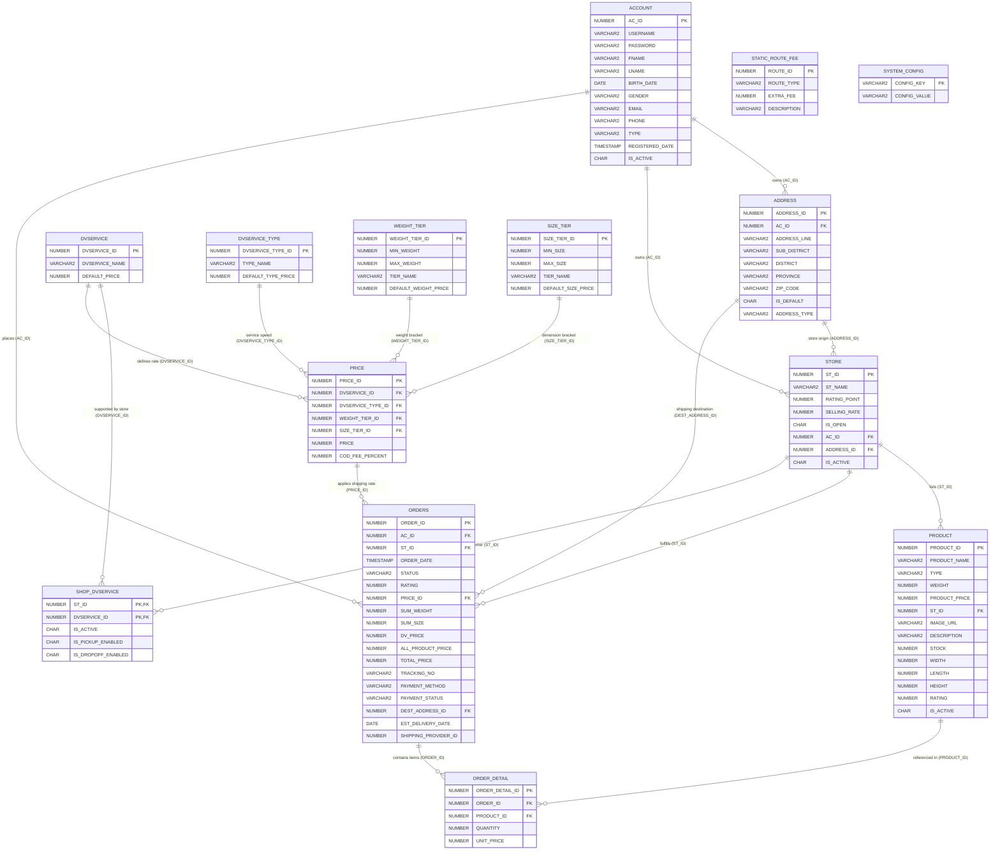

# 🛒 Online Medium Platform (CPE-303 Project)

<div align="center">

[](./README.md)
[-2563eb?style=for-the-badge)](./README.en.md)


**🌐 Switch Language: [🇹🇭 อ่านเวอร์ชันภาษาไทย (`README.md`)](./README.md) | 🇬🇧 English (Current)**

</div>

A comprehensive **Full-Stack E-Commerce & Multi-Vendor Marketplace Platform** supporting a **Multi-Role Ecosystem** (`Customer`, `Seller`, `Employee`, and `Admin`). Built with an **Oracle 21c** relational database, **Node.js + Express 5** backend, and a modern **React 19** frontend featuring a custom **Apple Liquid Glass UI Engine (WebGL Fragment Shader + SVG Displacement Refraction)**, multi-dimensional shipping fee calculation, partial cart checkout with automatic order splitting, and real-time delivery simulation.

---

## 📑 Table of Contents

1. [Project Overview & Role Capabilities](#-1-project-overview--role-capabilities)
2. [Architecture & Project Structure](#-2-architecture--project-structure)
3. [Part 1: Database Layer (Oracle 21c)](#-3-part-1-database-layer-oracle-21c)
   - [Entity-Relationship Diagram (ER Diagram)](#31-entity-relationship-diagram-er-diagram)
   - [Complete 13-Table Database Schema](#32-complete-13-table-database-schema)
   - [Database Design & Engineering Techniques](#33-database-design--engineering-techniques)
4. [Part 2: Backend Layer (Node.js & Express 5)](#-4-part-2-backend-layer-nodejs--express-5)
   - [Backend Stack & Configuration](#41-backend-stack--configuration)
   - [Complete RESTful API Reference](#42-complete-restful-api-reference)
   - [Backend Algorithms & Engineering Techniques](#43-backend-algorithms--engineering-techniques)
5. [Part 3: Frontend Layer (React 19)](#-5-part-3-frontend-layer-react-19)
   - [Pages & Core Components](#51-pages--core-components)
   - [Advanced Frontend Techniques](#52-advanced-frontend-techniques)
6. [Installation & Setup Guide](#-6-installation--setup-guide)

---

## 🌟 1. Project Overview & Role Capabilities

**Online Medium Platform** serves as an end-to-end marketplace connecting **Customers**, **Sellers**, **Logistics Employees**, and **System Administrators** within a unified platform:

| Role | Core Capabilities |
| :--- | :--- |
| **👤 Customer** | Search products & stores with instant categorized autocomplete, browse personalized product recommendations, manage multi-store shopping carts, perform partial cart checkouts, track live delivery progress bars in real time, confirm order receipt with 1–5 star ratings, manage shipping address books, and seamlessly switch roles to become a Seller. |
| **🏪 Seller** | All Customer capabilities + create and manage multiple storefronts, toggle store open/closed status (`IS_OPEN`), perform full CRUD on products (including parcel dimensions, weight, and stock), configure store origin addresses, and enable/disable supported delivery carriers per store. |
| **🚚 Employee** | Full control over the platform's logistics and multi-dimensional pricing engine across 7 management modules: Delivery Carriers (`DVSERVICE`), Service Types (`DVSERVICE_TYPE`), Weight Tiers (`WEIGHT_TIER`), Size Tiers (`SIZE_TIER`), 4D Price Matrix (`PRICE`), Static Route Fees (`STATIC_ROUTE_FEE`), and Global Delivery Simulation Delay (`SHIPPING_DELAY_SEC`). |
| **🛡️ Admin** | Full system privileges: manage user accounts across all roles, manage employee accounts, reassign or unassign store ownership (`Reassign Store Owner`), manage products across all stores, and configure all logistics settings. |

---

## 📂 2. Architecture & Project Structure

```text
CPE-303_Project/
├── be/                                 # Backend Server (Node.js + Express 5 + OracleDB)
│   ├── package.json                    # Backend dependencies (express, oracledb, cors, dotenv)
│   └── src/
│       ├── server.js                   # Main Express server implementing 40+ RESTful API endpoints
│       ├── config/
│       │   └── db.ts                   # Database connection configuration boilerplate (TypeScript)
│       ├── controllers/
│       │   └── article.controller.ts   # Sample controller structure
│       ├── middlewares/
│       │   └── auth.middleware.ts      # Sample authentication middleware
│       └── routes/
│           └── article.route.ts        # Sample route modularization
│
├── fe/                                 # Frontend Application (React 19)
│   ├── package.json                    # Frontend dependencies (react 19, react-router-dom v7)
│   ├── public/
│   │   └── index.html                  # Root HTML with blocking inline script for Zero-FOUC theme sync
│   └── src/
│       ├── index.js                    # React application entry point
│       ├── App.js                      # Application router, context providers, and layout shell
│       ├── index.css                   # CSS design tokens, Dark Mode overrides, and View Transitions
│       ├── App.css                     # Supplementary application styles
│       ├── LiquidGlassCard.jsx         # Reusable Apple Liquid Glass component (WebGL + SVG Refraction)
│       ├── components/
│       │   └── Navbar.js               # Top navigation bar, instant search engine, live cart badge, theme toggle
│       ├── context/
│       │   ├── ThemeContext.js         # Dark/Light mode manager with circular View Transitions API reveal
│       │   └── PopupContext.js         # Semantic NLP Toast notifications & Promise-based confirmation modals
│       └── Pages/
│           ├── Home.js                 # Marketplace home page with personalized feed, category filter & shuffle
│           ├── Product.js              # Detailed product view with parcel specs, store link & add-to-cart
│           ├── Store.js                # Storefront profile page showing ratings, total sales & store catalog
│           ├── Market.js               # Multi-store cart, partial checkout, and real-time delivery tracker
│           ├── OrderHistory.js         # Completed order archive with detailed digital receipt modal
│           ├── Profile.js              # Account settings, address book CRUD, and Customer/Seller role switcher
│           ├── ProductManager.js       # Multi-store & product management portal (for Sellers and Admins)
│           ├── ShippingManager.js      # 7-tab logistics & pricing matrix portal (for Employees and Admins)
│           ├── ManageUsers.js          # User account & store ownership management (for Admins)
│           ├── ManageEmployees.js      # Employee account management (for Admins)
│           ├── Login.js                # Authentication login page
│           ├── Register.js             # User registration page
│           └── NotFound.js             # 404 Not Found fallback page
├── README.md                           # Thai documentation (Default GitHub README)
└── README.en.md                        # English documentation
```

---

## 🗄️ 3. Part 1: Database Layer (Oracle 21c)

The platform is backed by **Oracle Database 21c (Express Edition - XEPDB1)** under the `HR` schema. The relational model consists of **13 tables** engineered to handle multi-role accounts, multi-store catalogs, persistent shopping carts, order fulfillment, and a 4-dimensional logistics pricing matrix.

### 3.1 Entity-Relationship Diagram (ER Diagram)



---

### 3.2 Complete 13-Table Database Schema

#### 1) User & Address Domain
* **`HR.ACCOUNT`** — Stores all user accounts across the platform.
  * **Primary Key**: `AC_ID` (`NUMBER`)
  * **Columns**: `USERNAME` (`VARCHAR2(50)`), `PASSWORD` (`VARCHAR2(255)`), `FNAME` (`VARCHAR2(100)`), `LNAME` (`VARCHAR2(100)`), `BIRTH_DATE` (`DATE`), `GENDER` (`VARCHAR2(10)`), `EMAIL` (`VARCHAR2(100)`), `PHONE` (`VARCHAR2(20)`), `TYPE` (`VARCHAR2(20)`: `'Customer'`, `'Seller'`, `'Employee'`, `'Admin'`), `REGISTERED_DATE` (`TIMESTAMP(6)`), `IS_ACTIVE` (`CHAR(1)`, default `'Y'`)
* **`HR.ADDRESS`** — Stores customer shipping addresses and seller store origin locations.
  * **Primary Key**: `ADDRESS_ID` (`NUMBER`)
  * **Foreign Key**: `AC_ID` references `HR.ACCOUNT(AC_ID)`
  * **Columns**: `ADDRESS_LINE` (`VARCHAR2(500)`), `SUB_DISTRICT` (`VARCHAR2(100)`), `DISTRICT` (`VARCHAR2(100)`), `PROVINCE` (`VARCHAR2(100)`), `ZIP_CODE` (`VARCHAR2(10)`), `IS_DEFAULT` (`CHAR(1)`), `ADDRESS_TYPE` (`VARCHAR2(20)`: `'HOME'` for customer delivery addresses, `'STORE'` for storefront origins)

#### 2) Store & Product Domain
* **`HR.STORE`** — Stores seller storefronts and aggregated performance metrics.
  * **Primary Key**: `ST_ID` (`NUMBER`)
  * **Foreign Keys**: `AC_ID` references `HR.ACCOUNT(AC_ID)` (nullable when a store is unassigned from an owner), `ADDRESS_ID` references `HR.ADDRESS(ADDRESS_ID)`
  * **Columns**: `ST_NAME` (`VARCHAR2(100)`), `RATING_POINT` (`NUMBER(3,2)` average store rating), `SELLING_RATE` (`NUMBER(10,2)` cumulative units sold), `IS_OPEN` (`CHAR(1)` open/closed toggle), `IS_ACTIVE` (`CHAR(1)`)
* **`HR.PRODUCT`** — Stores product catalog items, inventory count, and physical parcel dimensions/weight.
  * **Primary Key**: `PRODUCT_ID` (`NUMBER`)
  * **Foreign Key**: `ST_ID` references `HR.STORE(ST_ID)`
  * **Columns**: `PRODUCT_NAME` (`VARCHAR2(150)`), `TYPE` (`VARCHAR2(50)` category), `WEIGHT` (`NUMBER(8,2)` in kg), `PRODUCT_PRICE` (`NUMBER(10,2)`), `IMAGE_URL` (`VARCHAR2(500)`), `DESCRIPTION` (`VARCHAR2(2000)`), `STOCK` (`NUMBER(5,0)`), `WIDTH` (`NUMBER(6,2)`), `LENGTH` (`NUMBER(6,2)`), `HEIGHT` (`NUMBER(6,2)`), `RATING` (`NUMBER(3,2)`), `IS_ACTIVE` (`CHAR(1)`)

#### 3) Order & Cart Domain
* **`HR.ORDERS`** — Represents both active shopping carts (`STATUS = 'Cart'`) and placed orders (`'Pending'`, `'Delivered'`, `'Reviewed'`), grouped per store.
  * **Primary Key**: `ORDER_ID` (`NUMBER`)
  * **Foreign Keys**: `AC_ID` -> `HR.ACCOUNT`, `ST_ID` -> `HR.STORE`, `PRICE_ID` -> `HR.PRICE`, `DEST_ADDRESS_ID` -> `HR.ADDRESS`
  * **Columns**: `ORDER_DATE` (`TIMESTAMP(6)`), `STATUS` (`VARCHAR2(50)`), `RATING` (`NUMBER(3,2)`), `SUM_WEIGHT` (`NUMBER(8,2)`), `SUM_SIZE` (`NUMBER(8,2)`), `DV_PRICE` (`NUMBER(10,2)` calculated shipping cost), `ALL_PRODUCT_PRICE` (`NUMBER(10,2)` subtotal), `TOTAL_PRICE` (`NUMBER(10,2)` grand total), `TRACKING_NO` (`VARCHAR2(100)`), `PAYMENT_METHOD` (`VARCHAR2(50)`), `PAYMENT_STATUS` (`VARCHAR2(50)`), `EST_DELIVERY_DATE` (`DATE` target arrival timestamp), `SHIPPING_PROVIDER_ID` (`NUMBER`)
* **`HR.ORDER_DETAIL`** — Line items belonging to an order or shopping cart.
  * **Primary Key**: `ORDER_DETAIL_ID` (`NUMBER`)
  * **Foreign Keys**: `ORDER_ID` -> `HR.ORDERS(ORDER_ID)`, `PRODUCT_ID` -> `HR.PRODUCT(PRODUCT_ID)`
  * **Columns**: `QUANTITY` (`NUMBER(5,0)`), `UNIT_PRICE` (`NUMBER(10,2)` historical price snapshot at purchase time)

#### 4) Logistics & Pricing Engine Domain
* **`HR.DVSERVICE`** — Delivery carrier companies (e.g., Kerry, Flash, Thailand Post).
  * **Primary Key**: `DVSERVICE_ID` (`NUMBER`) | **Columns**: `DVSERVICE_NAME` (`VARCHAR2(100)`), `DEFAULT_PRICE` (`NUMBER(10,2)`)
* **`HR.SHOP_DVSERVICE`** — Many-to-Many (M:N) junction table linking stores to their enabled delivery carriers.
  * **Composite Primary Key / Foreign Keys**: `(ST_ID, DVSERVICE_ID)`
  * **Columns**: `IS_ACTIVE` (`CHAR(1)`), `IS_PICKUP_ENABLED` (`CHAR(1)`), `IS_DROPOFF_ENABLED` (`CHAR(1)`)
* **`HR.DVSERVICE_TYPE`** — Delivery speed tiers (e.g., Standard, Express, Same-Day).
  * **Primary Key**: `DVSERVICE_TYPE_ID` (`NUMBER`) | **Columns**: `TYPE_NAME` (`VARCHAR2(50)`), `DEFAULT_TYPE_PRICE` (`NUMBER(10,2)`)
* **`HR.WEIGHT_TIER`** — Parcel weight brackets.
  * **Primary Key**: `WEIGHT_TIER_ID` (`NUMBER`) | **Columns**: `MIN_WEIGHT` (`NUMBER(8,2)`), `MAX_WEIGHT` (`NUMBER(8,2)`), `TIER_NAME` (`VARCHAR2(50)`), `DEFAULT_WEIGHT_PRICE` (`NUMBER(10,2)`)
* **`HR.SIZE_TIER`** — Parcel combined dimension brackets ($\text{Width} + \text{Length} + \text{Height}$).
  * **Primary Key**: `SIZE_TIER_ID` (`NUMBER`) | **Columns**: `MIN_SIZE` (`NUMBER(8,2)`), `MAX_SIZE` (`NUMBER(8,2)`), `TIER_NAME` (`VARCHAR2(50)`), `DEFAULT_SIZE_PRICE` (`NUMBER(10,2)`)
* **`HR.PRICE`** — Central 4-dimensional shipping rate lookup table.
  * **Primary Key**: `PRICE_ID` (`NUMBER`)
  * **Foreign Keys**: `DVSERVICE_ID`, `DVSERVICE_TYPE_ID`, `WEIGHT_TIER_ID`, `SIZE_TIER_ID`
  * **Columns**: `PRICE` (`NUMBER(10,2)`), `COD_FEE_PERCENT` (`NUMBER(4,2)`)
* **`HR.STATIC_ROUTE_FEE`** & **`HR.SYSTEM_CONFIG`** — Route surcharges and global key-value configuration.
  * `STATIC_ROUTE_FEE`: Defines extra charges based on origin/destination province comparison (`ROUTE_TYPE`: `'SAME_PROVINCE'` vs. `'CROSS_PROVINCE'`, `EXTRA_FEE`).
  * `SYSTEM_CONFIG`: Stores dynamic runtime settings (`CONFIG_KEY`, `CONFIG_VALUE`), such as `SHIPPING_DELAY_SEC` for real-time delivery simulation.

---

### 3.3 Database Design & Engineering Techniques

1. **Soft Delete Pattern for Referential Integrity (`IS_ACTIVE = 'Y'/'N'`)**
   - Core entities referenced by historical transactions (`ACCOUNT`, `STORE`, `PRODUCT`, `SHOP_DVSERVICE`) use an `IS_ACTIVE` flag rather than destructive `DELETE` statements.
   - Ensures historical receipts and order histories (`ORDERS` / `ORDER_DETAIL`) remain intact and can still join against product names, store names, and user profiles even after a product or store is removed from active listings.
2. **Draft Order Pattern (Database-Backed Multi-Store Cart)**
   - Instead of storing cart items in volatile browser `localStorage`, active shopping carts are persisted directly in `HR.ORDERS` (`STATUS = 'Cart'`) and `HR.ORDER_DETAIL`, automatically partitioned by store (`ST_ID`).
   - Provides cross-device cart persistence and seamless state transitions (`'Cart'` $\rightarrow$ `'Pending'` $\rightarrow$ `'Delivered'` $\rightarrow$ `'Reviewed'`).
3. **Multi-Dimensional Tier-Based Rate Lookup**
   - Decouples logistics pricing into 4 orthogonal dimensions (`DVSERVICE`, `DVSERVICE_TYPE`, `WEIGHT_TIER`, `SIZE_TIER`) joined via `HR.PRICE` and augmented by `HR.STATIC_ROUTE_FEE`.
   - Uses SQL range predicates (`BETWEEN MIN_WEIGHT AND MAX_WEIGHT` and `BETWEEN MIN_SIZE AND MAX_SIZE`), allowing logistics staff to adjust rate brackets dynamically without code changes.
4. **Historical Price Snapshot (`ORDER_DETAIL.UNIT_PRICE`)**
   - Copies `PRODUCT.PRODUCT_PRICE` into `ORDER_DETAIL.UNIT_PRICE` when items are added/checked out, guaranteeing that future product price changes never alter historical order receipts.
5. **Dynamic ID Generation & Oracle Date Arithmetic**
   - Uses `SELECT NVL(MAX(ID), 0) + 1` for deterministic primary key allocation and leverages Oracle date arithmetic (`CURRENT_DATE + (:delaySec / 86400)`) to compute second-accurate estimated delivery timestamps (`EST_DELIVERY_DATE`).

---

## ⚙️ 4. Part 2: Backend Layer (Node.js & Express 5)

### 4.1 Backend Stack & Configuration
* **Runtime & Web Framework**: Node.js with **Express v5.2.1**
* **Database Connectivity**: **node-oracledb v7.1.0** utilizing an asynchronous Connection Pool (`poolMin: 2`, `poolMax: 10`, `poolIncrement: 2`) for high-concurrency query execution.
* **Driver Configuration**: Configured with `oracledb.outFormat = oracledb.OUT_FORMAT_OBJECT` for automatic row-to-JSON mapping and `oracledb.autoCommit = true`.

---

### 4.2 Complete RESTful API Reference

#### 🔐 1) Authentication & Account Management
| Method | Endpoint | Description |
| :--- | :--- | :--- |
| `POST` | `/api/auth/register` | Register a new customer account (catches Oracle `ORA-00001` unique constraint violations). |
| `POST` | `/api/auth/login` | Authenticate user credentials and verify `IS_ACTIVE = 'Y'`. |
| `PUT` | `/api/auth/update` | Update profile details (returns `requireRelogin: true` when Email or Password changes). |
| `DELETE` | `/api/auth/delete/:acId` | Soft-delete own user account (`IS_ACTIVE = 'N'`). |
| `GET` | `/api/account/profile` | Retrieve latest user profile by `acId`. |
| `POST` | `/api/account/switch-role` | Toggle role between `Customer` and `Seller` (switching back to `Customer` automatically closes all owned stores). |

#### 📍 2) Address Book Management
| Method | Endpoint | Description |
| :--- | :--- | :--- |
| `GET` | `/api/addresses` | List customer shipping addresses (`ADDRESS_TYPE = 'HOME'`), sorted with `IS_DEFAULT = 'Y'` first. |
| `POST` | `/api/addresses` | Add a new address (automatically sets `IS_DEFAULT = 'Y'` if it is the user's first address). |
| `PUT` | `/api/addresses/:id` | Update an existing address. |
| `PUT` | `/api/addresses/:id/default` | Set an address as default (resets other addresses of the same user to `'N'` before setting target to `'Y'`). |
| `DELETE` | `/api/addresses/:id` | Delete an address (if the deleted address was default, automatically promotes the next most recent address to default). |

#### 🛍️ 3) Products & Storefronts
| Method | Endpoint | Description |
| :--- | :--- | :--- |
| `GET` | `/api/products` | Fetch all active products ranked by the personalized recommendation engine (`acId`) or randomized (`shuffle=true`). |
| `GET` | `/api/products/:id` | Fetch full product specifications, stock, and associated store details. |
| `POST` | `/api/products` | Create a new product under a store. |
| `PUT` | `/api/products/:id` | Update product details, parcel dimensions, weight, and stock. |
| `DELETE` | `/api/products/:id` | Soft-delete a product (`IS_ACTIVE = 'N'`). |
| `GET` | `/api/stores` | List all active stores (`IS_ACTIVE = 'Y'`). |
| `GET` | `/api/stores/owner/:acId` | List all active stores owned by a specific Seller. |
| `GET` | `/api/stores/:id` | Fetch storefront profile and all active products in that store. |
| `POST` | `/api/stores` | Create a new store for a Seller. |
| `PUT` | `/api/stores/:id/status` | Toggle store open/closed status (`IS_OPEN = 'Y'/'N'`). |
| `DELETE` | `/api/stores/:id` | Soft-delete a store (`IS_ACTIVE = 'N'`, `IS_OPEN = 'N'`) and cascade soft-delete to all its products. |
| `PUT` | `/api/stores/:stId/address` | Create or update a store's origin address (`ADDRESS_TYPE = 'STORE'`). |
| `GET` | `/api/stores/:stId/dvservices` | Get delivery carriers enabled for a specific store. |
| `POST` | `/api/stores/:stId/dvservices` | Save enabled delivery carriers for a store in `HR.SHOP_DVSERVICE`. |

#### 🛒 4) Cart, Shipping Calculation & Order Fulfillment
| Method | Endpoint | Description |
| :--- | :--- | :--- |
| `GET` | `/api/cart` | Fetch user's active store carts (`STATUS = 'Cart'`) along with each store's enabled carriers. |
| `POST` | `/api/cart/add` | Add item to cart (verifies store is open and stock is sufficient; increments quantity if already in cart). |
| `PUT` | `/api/cart/update` | Update cart item quantity and recalculate order subtotal. |
| `DELETE` | `/api/cart/item/:detailId` | Remove an item from the cart (removes parent `ORDERS` row if the last item in that store cart is deleted). |
| `POST` | `/api/cart/calculate-shipping`| Calculate real-time shipping fee preview for selected items, carrier, service speed, and destination address. |
| `POST` | `/api/cart/checkout` | Execute checkout supporting partial item selection, dynamic order splitting, stock deduction, and tracking number generation. |
| `GET` | `/api/orders` | Fetch user orders and automatically transition `Pending -> Delivered` for orders past `EST_DELIVERY_DATE`. |
| `POST` | `/api/orders/:orderId/receive`| Confirm order receipt, submit 1–5 star rating, and recalculate product rating, store rating, and store selling rate. |

#### 🚚 5) Logistics Configuration & Admin Portal
| Method | Endpoint | Description |
| :--- | :--- | :--- |
| `GET/POST/PUT/DELETE` | `/api/dvservices`, `/api/dvservice-types` | Full CRUD for delivery carriers and service speed types. |
| `GET/POST/PUT/DELETE` | `/api/weight-tiers`, `/api/size-tiers` | Full CRUD for weight brackets and combined dimension brackets. |
| `GET/POST/PUT/DELETE` | `/api/prices` | Full CRUD for the 4D shipping price lookup table. |
| `GET/PUT` | `/api/route-fees` | View and update domestic route fees (`SAME_PROVINCE` and `CROSS_PROVINCE`). |
| `GET/PUT` | `/api/config/shipping-delay` | View and update the global delivery simulation timer (`SHIPPING_DELAY_SEC`). |
| `GET/POST/PUT/DELETE` | `/api/admin/users` | Full CRUD for user and employee accounts (Admin only). |
| `PUT` | `/api/admin/stores/:stId/reassign` | Reassign store ownership to another Seller or unassign owner (`AC_ID = NULL`). |

---

### 4.3 Backend Algorithms & Engineering Techniques

#### 1) Personalized Recommendation & Deterministic Cold-Start Scoring (`GET /api/products`)
When fetching the marketplace catalog, the backend analyzes the user's past orders (`ORDERS` + `ORDER_DETAIL`) to build frequency maps of preferred product categories (`typeCnt`) and stores (`storeCnt`). Each product is assigned a composite score (`_score`):

$$\text{Score} = \text{OpenBonus} + (\text{typeCnt} \times 2000) + (\text{storeCnt} \times 1000) + (\text{Rating} \times 50) + \text{ColdStartHash}$$

* **Open Store Priority (`OpenBonus`)**: Products from open stores (`IS_OPEN = 'Y'`) receive `+100,000` points so closed stores always appear at the bottom.
* **Cold-Start Deterministic Pseudo-Random Hash**: For new users with no purchase history, the system computes a deterministic trigonometric hash seeded by `acId` and `PRODUCT_ID`:
  ```javascript
  const hash = Math.abs(Math.sin(acId * 137 + p.PRODUCT_ID * 79)) * 500;
  ```
  This provides a tailored, varied feed per user that stays stable across page reloads while supporting an explicit **Fisher-Yates Shuffle** when `shuffle=true` is requested.

#### 2) Partial Cart Checkout & Dynamic Order Splitting (`POST /api/cart/checkout`)
Users can select any subset of items across multiple stores to check out at once:
1. **Pre-Flight Stock & Store Validation**: Verifies every selected item belongs to an open store (`IS_OPEN === 'Y'`) and has sufficient inventory (`STOCK >= QUANTITY`) before mutating any data.
2. **Dynamic Order Splitting**:
   - **Full Store Cart Checkout**: If all items in a store's `'Cart'` order are selected, the existing `ORDERS` record is promoted directly to `STATUS = 'Pending'`.
   - **Partial Store Cart Checkout**: If only a subset of items in a store's cart is selected, the backend creates a new `ORDERS` record (`newOrderId`) for the checked-out items, reassigns the selected `ORDER_DETAIL` rows to `newOrderId`, and recalculates `ALL_PRODUCT_PRICE` and `TOTAL_PRICE` on the remaining `'Cart'` order.

#### 3) Multi-Factor Shipping Fee Engine (`POST /api/cart/calculate-shipping`)
Shipping fees are dynamically computed per store order from 5 physical and geographical factors:
1. **Total Parcel Weight (`sumWeight`)**: $\sum (\text{QUANTITY} \times \text{WEIGHT})$
2. **Total Parcel Dimensions (`sumSize`)**: $\sum (\text{QUANTITY} \times (\text{WIDTH} + \text{LENGTH} + \text{HEIGHT}))$
3. **Tier Bracket Matching**: Matches `sumWeight` against `WEIGHT_TIER` and `sumSize` against `SIZE_TIER` using SQL `BETWEEN` (with automatic fallback to the highest tier if a parcel exceeds maximum defined bounds).
4. **Origin vs. Destination Province Comparison (`STATIC_ROUTE_FEE`)**: Compares the seller store's `PROVINCE` (`STORE.ADDRESS_ID`) with the buyer's delivery `PROVINCE` (`DEST_ADDRESS_ID`) to apply either the `SAME_PROVINCE` or `CROSS_PROVINCE` surcharge.
5. **Final Shipping Fee Aggregation (`dvPrice`)**:
   $$\text{dvPrice} = \text{BasePrice} + \text{DefaultServicePrice} + \text{DefaultTypePrice} + \text{DefaultWeightPrice} + \text{DefaultSizePrice} + \text{RouteExtraFee}$$

#### 4) Real-Time Delivery Simulation & Auto-Status Transition (`GET /api/orders`)
* Upon checkout, the backend reads `SHIPPING_DELAY_SEC` from `HR.SYSTEM_CONFIG` and sets `EST_DELIVERY_DATE = CURRENT_DATE + (:delaySec / 86400)`.
* Whenever `GET /api/orders` is called, the backend executes an automatic state transition query before returning results:
  ```sql
  UPDATE HR.ORDERS
  SET STATUS = 'Delivered'
  WHERE AC_ID = :acId AND STATUS = 'Pending'
    AND EST_DELIVERY_DATE IS NOT NULL AND CURRENT_DATE >= EST_DELIVERY_DATE
  ```

#### 5) Cascading Review, Rating & Selling Rate Aggregation (`POST /api/orders/:orderId/receive`)
When a customer confirms delivery and submits a star rating (1–5 stars):
1. Marks the order as `STATUS = 'Reviewed'` and `PAYMENT_STATUS = 'Approved'`.
2. Recalculates the average rating (`AVG(RATING)`) for every product in that order and updates `HR.PRODUCT.RATING`.
3. Recalculates the store's `HR.STORE.RATING_POINT` from the average rating of its products (with **Schema Fallback Resilience** that automatically falls back to `AVG(ORDERS.RATING)` if the database schema lacks the `PRODUCT.RATING` column).
4. Recalculates the store's cumulative sales volume (`HR.STORE.SELLING_RATE`) using `SUM(ORDER_DETAIL.QUANTITY)` across all completed/active orders.

---

## 🎨 5. Part 3: Frontend Layer (React 19)

### 5.1 Pages & Core Components

| File / Component | Role & Key Features |
| :--- | :--- |
| **`LiquidGlassCard.jsx`** | Reusable Apple Liquid Glass UI surface powered by a custom WebGL 1.0 Fragment Shader and real-time SVG `<feDisplacementMap>` backdrop refraction. |
| **`components/Navbar.js`** | Sticky glass navigation bar featuring categorized instant search autocomplete (Categories, Stores, Products), live cart item counter, and theme toggle button. |
| **`Pages/Home.js`** | Main marketplace view with category filter pills, product shuffle button, and responsive product grid with closed-store badges. |
| **`Pages/Product.js`** | Product detail view displaying parcel dimensions, weight, available stock, ratings, store profile link, and quantity selector. |
| **`Pages/Store.js`** | Dedicated storefront page displaying store rating, total items sold, origin province, open/closed banner, and store product catalog. |
| **`Pages/Market.js`** | Unified order center with 3 tabs: **Shopping Cart** (partial selection & carrier picker), **Awaiting Delivery** (live `LiquidGlassCard` wave progress bar), and **Rate Products**. |
| **`Pages/OrderHistory.js`** | Archive of completed orders with an interactive full receipt modal. |
| **`Pages/Profile.js`** | User profile editor, shipping address book manager, one-click `Customer <-> Seller` role switcher, and account deactivation. |
| **`Pages/ProductManager.js`** | Multi-store management portal for Sellers and Admins to create stores, toggle open status, set store origin addresses, select carriers, and manage inventory. |
| **`Pages/ShippingManager.js`** | 7-tab logistics control center for Employees and Admins to manage carriers, service types, weight/size tiers, 4D pricing rules, route fees, and delivery delay timer. |
| **`Pages/ManageUsers.js` & `ManageEmployees.js`** | Admin portals for managing user/employee accounts and reassigning store ownership. |

---

### 5.2 Advanced Frontend Techniques

#### 1) Hybrid WebGL + SVG Displacement Liquid Glass Engine (`LiquidGlassCard.jsx`)
The platform implements an authentic **Apple Liquid Glass** surface effect using a two-layer hybrid rendering pipeline at 60 FPS:
* **Layer 1 — Real DOM Refraction via SVG `<feDisplacementMap>` (`backdrop-filter`)**:
  - Dynamically renders an R/G normal displacement map onto an offscreen HTML5 Canvas using a cubic bevel profile $p = (1 - t)^3$, encoding X-axis displacement into the Red channel and Y-axis displacement into the Green channel.
  - Feeds the Canvas Data URL into an inline SVG `<filter>` (`<feImage>` $\rightarrow$ `<feGaussianBlur>` $\rightarrow$ `<feDisplacementMap>`) applied via CSS `backdrop-filter: url(#filterId)`, refracting live DOM content behind the card.
* **Layer 2 — Custom WebGL 1.0 Fragment Shader (GLSL)**:
  - Computes pixel-accurate rounded rectangle distance fields using a **Signed Distance Function (`sdRoundedBox`)**.
  - Renders 3D bevel edge normals (`pow(edgeFactor, 2.5)`), interactive **Mouse Lens Dent** distortion around the cursor, specular rim highlights, and Fresnel edge glow.
  - **Physics-Based Liquid Wave Simulation**: In progress-bar mode (`isLiquidWave={true}`), a `ResizeObserver` tracks real-time expansion velocity (`u_velX`, `u_velY`) and drives multi-harmonic Sine/Cosine wave equations inside the GLSL shader to simulate sloshing liquid at the leading edge of the delivery bar.

#### 2) Circular View Transitions API Theme Toggle & Zero-FOUC (`ThemeContext.js` & `index.css`)
* **Zero-FOUC (Flash of Unstyled Content Prevention)**: A synchronous inline script in `public/index.html` inspects `localStorage` and `window.matchMedia('(prefers-color-scheme: dark)')` to apply the `.dark` class on `<html>` before the browser's first paint.
* **Circular Clip-Path Reveal Animation**: Clicking the theme toggle captures the exact button coordinates `(x, y)`, calculates the maximum radius to the farthest viewport corner via `Math.hypot()`, and invokes `document.startViewTransition()` paired with React's `flushSync()` to animate `::view-transition-new(root)` with an expanding `clipPath: circle(...)`.
* **Snapshot Transition Freeze**: Temporarily applies a `theme-transitioning` class during snapshot capture to disable element-level CSS transitions and eliminate main-thread repaint lag.
* **Modern CSS Color Pipeline**: Leverages CSS `light-dark()`, `in oklab` color-space gradients, `:has()` relational selectors, `@property --spinner-angle` conic-gradient spinners, and an **Attribute Selector Override Engine (`[style*=...]`)** in `index.css` that automatically adapts inline-styled components to Dark Mode.

#### 3) Semantic NLP Toast Notification & Promise-Based Confirmation Modal (`PopupContext.js`)
* **Replaces Native Blocking Dialogs**: Replaces all `window.alert` and `window.confirm` calls across the app with a custom React Context provider (`usePopup`).
* **Semantic Keyword Auto-Inference (`inferToastType`)**: Automatically inspects notification messages (Thai/English keywords and emojis) to classify toasts into `success`, `error`, `warning`, or `info` themes with an animated 3.8-second countdown bar.
* **Promise-Based Modal Queue (`await showConfirm()`)**: Exposes an `async/await`-compatible confirmation modal (`if (!(await showConfirm("..."))) return;`) with automatic danger-keyword detection (`isDangerConfirm`) that styles destructive actions in red and binds the `Escape` key for quick dismissal.

#### 4) Event-Driven Cross-Component Synchronization & Dual-Loop Delivery Tracker
* **Custom DOM Events (`cart-updated`)**: Adding items in `Home.js`/`Product.js` or checking out in `Market.js` dispatches `window.dispatchEvent(new CustomEvent("cart-updated"))`, allowing `Navbar.js` to synchronize the cart badge count immediately without prop drilling.
* **Real-Time Dual-Loop Delivery Tracker (`Market.js`)**: Runs two concurrent timers — a **1-second UI tick** that interpolates `getDeliveryProgress(order)` so the `LiquidGlassCard` progress bar glides smoothly, and a **3-second backend polling loop** that automatically moves delivered orders into the "Rate Products" tab once `EST_DELIVERY_DATE` is reached.
* **React Portal (`createPortal`)**: Renders the checkout confirmation modal directly into `document.body` to prevent clipping or stacking-context conflicts.

---

## 🚀 6. Installation & Setup Guide

### Prerequisites
1. **Node.js** (v18+ recommended) and **npm**
2. **Oracle Database 21c (Express Edition)** running service `XEPDB1` with the `HR` schema tables initialized

---

### Step 1: Configure & Run the Backend (`be/`)

1. Open a terminal and navigate to the `be` directory:
   ```bash
   cd be
   npm install
   ```
2. Verify your Oracle Database credentials in `be/src/server.js` (or configure via a `.env` file):
   ```env
   DB_USER=system
   DB_PASSWORD=your_database_password
   DB_CONNECT_STRING=localhost:1521/XEPDB1
   PORT=3100
   ```
3. Start the Backend server:
   ```bash
   # Development mode (auto-reload via nodemon)
   npm run dev

   # Or production start
   npm start
   ```
   > The Backend API server will run at `http://localhost:3100`.

---

### Step 2: Configure & Run the Frontend (`fe/`)

1. Open a new terminal and navigate to the `fe` directory:
   ```bash
   cd fe
   npm install
   ```
2. Start the React development server:
   ```bash
   npm start
   ```
   > The Frontend web application will launch at `http://localhost:3000` and connect to `http://localhost:3100`.

