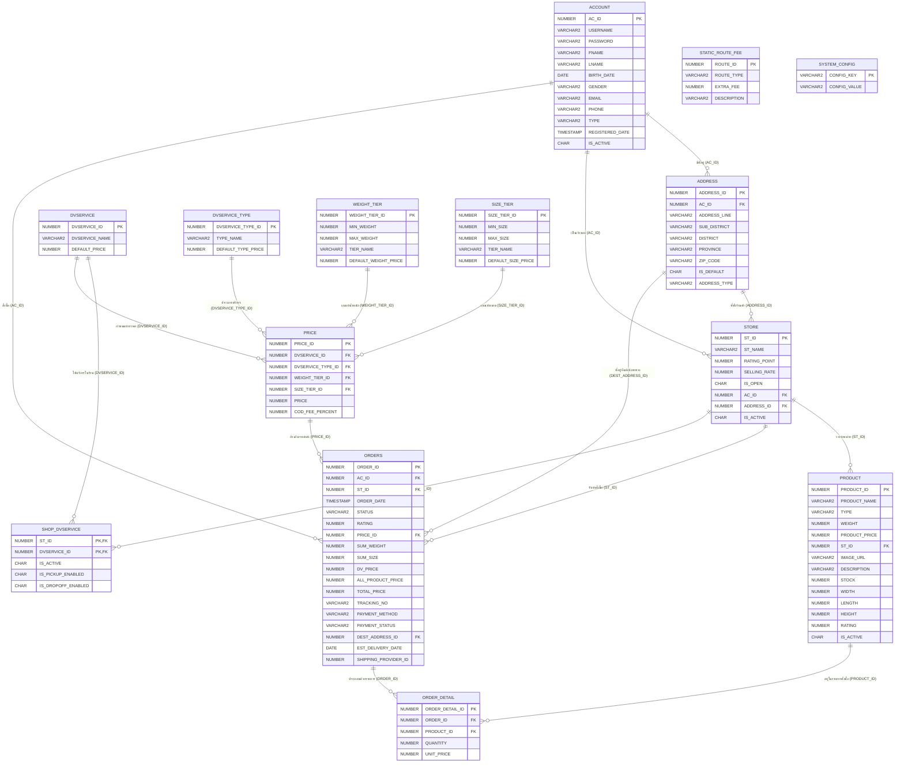

# 🛒 Online Medium Platform (CPE-303 Project)

<div align="center">

[-2563eb?style=for-the-badge)](./README.md)
[](./README.en.md)


**🌐 เปลี่ยนภาษา (Switch Language): 🇹🇭 ภาษาไทย (ปัจจุบัน) | [🇬🇧 Read in English (`README.en.md`)](./README.en.md)**

</div>

ระบบแพลตฟอร์มตลาดซื้อขายสินค้าออนไลน์แบบครบวงจร (**Full-Stack E-Commerce & Multi-Vendor Marketplace Platform**) ที่รองรับการทำงานแบบหลายบทบาท (**Multi-Role System**: ลูกค้า, ผู้ขาย, พนักงานจัดการระบบขนส่ง, และผู้ดูแลระบบ) พร้อมระบบคำนวณค่าขนส่งหลายมิติ ระบบตะกร้าสินค้าและการแยกคำสั่งซื้ออัตโนมัติ ระบบจำลองการจัดส่งแบบเรียลไทม์ และส่วนติดต่อผู้ใช้สไตล์ **Apple Liquid Glass (WebGL + SVG Refraction)**

---

## 📑 สารบัญ (Table of Contents)

1. [ภาพรวมระบบและฟีเจอร์หลัก (Project Overview)](#-1-ภาพรวมระบบและฟีเจอร์หลัก-project-overview)
2. [สถาปัตยกรรมและโครงสร้างโปรเจกต์ (Project Structure)](#-2-สถาปัตยกรรมและโครงสร้างโปรเจกต์-project-structure)
3. [ส่วนที่ 1: ระบบฐานข้อมูล (Database Layer - Oracle 21c)](#-3-ส่วนที่-1-ระบบฐานข้อมูล-database-layer---oracle-21c)
   - [แผนภาพความสัมพันธ์ของข้อมูล (ER Diagram)](#31-แผนภาพความสัมพันธ์ของข้อมูล-er-diagram)
   - [รายละเอียดตารางทั้งหมด 13 ตาราง (Database Schema)](#32-รายละเอียดตารางทั้งหมด-13-ตาราง-database-schema)
   - [เทคนิคและการออกแบบฝั่งฐานข้อมูล (Database Techniques)](#33-เทคนิคและการออกแบบฝั่งฐานข้อมูล-database-techniques)
4. [ส่วนที่ 2: ระบบฝั่งเซิร์ฟเวอร์ (Backend Layer - Node.js & Express)](#-4-ส่วนที่-2-ระบบฝั่งเซิร์ฟเวอร์-backend-layer---nodejs--express)
   - [โครงสร้างและเทคโนโลยีฝั่ง Backend](#41-โครงสร้างและเทคโนโลยีฝั่ง-backend)
   - [รายการ API Endpoints ทั้งหมด](#42-รายการ-api-endpoints-ทั้งหมด)
   - [เทคนิคและอัลกอริทึมฝั่ง Backend (Backend Techniques)](#43-เทคนิคและอัลกอริทึมฝั่ง-backend-backend-techniques)
5. [ส่วนที่ 3: ระบบฝั่งส่วนติดต่อผู้ใช้ (Frontend Layer - React 19)](#-5-ส่วนที่-3-ระบบฝั่งส่วนติดต่อผู้ใช้-frontend-layer---react-19)
   - [โครงสร้างหน้าเว็บและคอมโพเนนต์ (Pages & Components)](#51-โครงสร้างหน้าเว็บและคอมโพเนนต์-pages--components)
   - [เทคนิคขั้นสูงฝั่ง Frontend (Frontend Techniques)](#52-เทคนิคขั้นสูงฝั่ง-frontend-frontend-techniques)
6. [การติดตั้งและเริ่มต้นใช้งาน (Installation & Setup)](#-6-การติดตั้งและเริ่มต้นใช้งาน-installation--setup)

---

## 🌟 1. ภาพรวมระบบและฟีเจอร์หลัก (Project Overview)

**Online Medium Platform** เป็นระบบตัวกลางสำหรับการซื้อขายสินค้าออนไลน์ที่เชื่อมโยงระหว่าง **ผู้ซื้อ (Customer)**, **ผู้ขาย/ร้านค้า (Seller)**, **พนักงานจัดการขนส่ง (Employee)** และ **ผู้ดูแลระบบ (Admin)** เข้าด้วยกัน โดยแบ่งสิทธิ์และฟีเจอร์ตามบทบาทของผู้ใช้งานดังนี้:

| บทบาท (Role) | ความสามารถหลักในระบบ |
| :--- | :--- |
| **👤 Customer (ลูกค้า)** | ค้นหาสินค้าและร้านค้า, ดูสินค้าแนะนำเฉพาะบุคคล, จัดการตะกร้าสินค้าแยกตามร้านค้า, เลือกชำระเงินเฉพาะบางรายการ (Partial Checkout), ติดตามสถานะการจัดส่งแบบเรียลไทม์, ยืนยันรับสินค้าและให้คะแนนรีวิว (1–5 ดาว), จัดการสมุดที่อยู่จัดส่ง และสลับบทบาทเป็นผู้ขายได้ทันที |
| **🏪 Seller (ผู้ขาย)** | สิทธิ์ทั้งหมดของ Customer + สร้างและจัดการร้านค้าของตนเองหลายร้าน, เปิด/ปิดสถานะร้านค้าชั่วคราว, เพิ่ม/แก้ไข/ลบสินค้าและจัดการสต็อกพร้อมขนาด-น้ำหนักพัสดุ, ตั้งค่าที่อยู่ต้นทางของร้านค้า และเลือกเปิดใช้งานบริษัทขนส่งประจำร้าน |
| **🚚 Employee (พนักงาน)** | จัดการระบบโลจิสติกส์และโครงสร้างราคาค่าจัดส่งทั้งหมด ได้แก่ บริษัทขนส่ง (`DVSERVICE`), ประเภทบริการ (`DVSERVICE_TYPE`), เกณฑ์น้ำหนัก (`WEIGHT_TIER`), เกณฑ์ขนาดพัสดุ (`SIZE_TIER`), ตารางจับคู่ราคา (`PRICE`), ค่าธรรมเนียมข้ามจังหวัด (`STATIC_ROUTE_FEE`) และตั้งค่าเวลาจำลองการจัดส่ง (`SHIPPING_DELAY_SEC`) |
| **🛡️ Admin (ผู้ดูแลระบบ)** | สิทธิ์สูงสุดในระบบ สามารถจัดการบัญชีผู้ใช้ทุกบทบาท, จัดการพนักงาน, เปลี่ยนเจ้าของร้านค้าหรือถอดถอนเจ้าของร้าน (`Reassign Store Owner`), เข้าถึงหน้าจัดการสินค้าของทุกร้านค้า และจัดการตั้งค่าระบบขนส่งทั้งหมด |

---

## 📂 2. สถาปัตยกรรมและโครงสร้างโปรเจกต์ (Project Structure)

```text
CPE-303_Project/
├── be/                                 # ฝั่งเซิร์ฟเวอร์ (Backend - Node.js + Express 5 + OracleDB)
│   ├── package.json                    # Dependencies ฝั่ง Backend (express, oracledb, cors, dotenv)
│   └── src/
│       ├── server.js                   # ไฟล์หลักของเซิร์ฟเวอร์ รวม RESTful API ทั้งหมด 40+ Endpoints
│       ├── config/
│       │   └── db.ts                   # โมดูลตั้งค่าการเชื่อมต่อฐานข้อมูล (TypeScript Boilerplate)
│       ├── controllers/
│       │   └── article.controller.ts   # ตัวอย่าง Controller โครงสร้างเริ่มต้น
│       ├── middlewares/
│       │   └── auth.middleware.ts      # ตัวอย่าง Middleware ตรวจสอบสิทธิ์
│       └── routes/
│           └── article.route.ts        # ตัวอย่างการแยก Route
│
├── fe/                                 # ฝั่งส่วนติดต่อผู้ใช้ (Frontend - React 19)
│   ├── package.json                    # Dependencies ฝั่ง Frontend (react 19, react-router-dom v7)
│   ├── public/
│   │   └── index.html                  # HTML หลัก พร้อม Inline Script ป้องกันแสงกะพริบ (Zero-FOUC)
│   └── src/
│       ├── index.js                    # จุดเริ่มต้นของแอปพลิเคชัน React
│       ├── App.js                      # ตั้งค่า Routing, Providers และโครงสร้างหน้าเว็บหลัก
│       ├── index.css                   # ระบบตัวแปรสี CSS, Dark Mode Overrides และ View Transitions
│       ├── App.css                     # สไตล์เสริมของแอปพลิเคชัน
│       ├── LiquidGlassCard.jsx         # คอมโพเนนต์กระจกเหลว WebGL Fragment Shader + SVG Displacement
│       ├── components/
│       │   └── Navbar.js               # แถบนำทางด้านบน, ระบบค้นหาอัจฉริยะ, แจ้งเตือนตะกร้า และสลับธีม
│       ├── context/
│       │   ├── ThemeContext.js         # จัดการ Dark/Light Mode พร้อมแอนิเมชัน View Transitions API
│       │   └── PopupContext.js         # ระบบ Toast Notification อัจฉริยะและ Promise Confirmation Modal
│       └── Pages/
│           ├── Home.js                 # หน้าแรก แสดงสินค้าแนะนำ หมวดหมู่ และผลลัพธ์การค้นหา
│           ├── Product.js              # หน้ารายละเอียดสินค้าเชิงลึกและการหยิบใส่ตะกร้า
│           ├── Store.js                # หน้าร้านค้า แสดงข้อมูลร้าน คะแนน ยอดขาย และรายการสินค้าในร้าน
│           ├── Market.js               # หน้าตะกร้าสินค้า ชำระเงิน และติดตามสถานะพัสดุแบบเรียลไทม์
│           ├── OrderHistory.js         # หน้าประวัติการสั่งซื้อและดูใบเสร็จย้อนหลัง
│           ├── Profile.js              # หน้าจัดการข้อมูลส่วนตัว สมุดที่อยู่ และการสลับบทบาทผู้ใช้
│           ├── ProductManager.js       # หน้าจัดการร้านค้าและสินค้า (สำหรับ Seller และ Admin)
│           ├── ShippingManager.js      # หน้าจัดการระบบขนส่งและตารางราคา 7 แท็บ (สำหรับ Employee/Admin)
│           ├── ManageUsers.js          # หน้าจัดการผู้ใช้และโอนย้ายเจ้าของร้านค้า (สำหรับ Admin)
│           ├── ManageEmployees.js      # หน้าจัดการบัญชีพนักงาน (สำหรับ Admin)
│           ├── Login.js                # หน้าเข้าสู่ระบบ
│           ├── Register.js             # หน้าสมัครสมาชิกใหม่
│           └── NotFound.js             # หน้า 404 Not Found
├── README.md                           # เอกสารอธิบายโปรเจกต์ฉบับภาษาไทย (Default GitHub README)
└── README.en.md                        # เอกสารอธิบายโปรเจกต์ฉบับภาษาอังกฤษ (English Version)
```

---

## 🗄️ 3. ส่วนที่ 1: ระบบฐานข้อมูล (Database Layer - Oracle 21c)

ระบบใช้ฐานข้อมูลเชิงสัมพันธ์ **Oracle Database 21c (Express Edition - XEPDB1)** ภายใต้ Schema `HR` โดยออกแบบให้รองรับทั้งระบบบัญชีผู้ใช้หลายบทบาท ระบบร้านค้าและสินค้า ระบบคำสั่งซื้อ และระบบคำนวณอัตราค่าขนส่งแบบหลายมิติ รวมทั้งหมด **13 ตาราง**

### 3.1 แผนภาพความสัมพันธ์ของข้อมูล (ER Diagram)



---

### 3.2 รายละเอียดตารางทั้งหมด 13 ตาราง (Database Schema)

#### 1) กลุ่มผู้ใช้งานและที่อยู่ (User & Address Domain)
* **`HR.ACCOUNT`** — เก็บข้อมูลบัญชีผู้ใช้งานทั้งหมดในระบบ
  * **Primary Key**: `AC_ID` (`NUMBER`)
  * **Columns**: `USERNAME` (`VARCHAR2(50)`), `PASSWORD` (`VARCHAR2(255)`), `FNAME` (`VARCHAR2(100)`), `LNAME` (`VARCHAR2(100)`), `BIRTH_DATE` (`DATE`), `GENDER` (`VARCHAR2(10)`), `EMAIL` (`VARCHAR2(100)`), `PHONE` (`VARCHAR2(20)`), `TYPE` (`VARCHAR2(20)`: `'Customer'`, `'Seller'`, `'Employee'`, `'Admin'`), `REGISTERED_DATE` (`TIMESTAMP(6)`), `IS_ACTIVE` (`CHAR(1)` ค่าเริ่มต้น `'Y'`)
* **`HR.ADDRESS`** — เก็บข้อมูลสมุดที่อยู่ของลูกค้าและที่ตั้งของร้านค้า
  * **Primary Key**: `ADDRESS_ID` (`NUMBER`)
  * **Foreign Key**: `AC_ID` อ้างอิง `HR.ACCOUNT(AC_ID)`
  * **Columns**: `ADDRESS_LINE` (`VARCHAR2(500)`), `SUB_DISTRICT` (`VARCHAR2(100)`), `DISTRICT` (`VARCHAR2(100)`), `PROVINCE` (`VARCHAR2(100)`), `ZIP_CODE` (`VARCHAR2(10)`), `IS_DEFAULT` (`CHAR(1)`), `ADDRESS_TYPE` (`VARCHAR2(20)`: `'HOME'` สำหรับที่อยู่จัดส่งลูกค้า หรือ `'STORE'` สำหรับที่ตั้งร้านค้า)

#### 2) กลุ่มร้านค้าและสินค้า (Store & Product Domain)
* **`HR.STORE`** — เก็บข้อมูลร้านค้าของผู้ขาย
  * **Primary Key**: `ST_ID` (`NUMBER`)
  * **Foreign Keys**: `AC_ID` อ้างอิง `HR.ACCOUNT(AC_ID)` (อนุญาตให้เป็น `NULL` ได้กรณีร้านค้าถูกถอดเจ้าของ), `ADDRESS_ID` อ้างอิง `HR.ADDRESS(ADDRESS_ID)`
  * **Columns**: `ST_NAME` (`VARCHAR2(100)`), `RATING_POINT` (`NUMBER(3,2)` คะแนนรีวิวเฉลี่ย), `SELLING_RATE` (`NUMBER(10,2)` ยอดจำนวนสินค้าที่ขายได้สะสม), `IS_OPEN` (`CHAR(1)` สถานะเปิด/ปิดร้าน), `IS_ACTIVE` (`CHAR(1)`)
* **`HR.PRODUCT`** — เก็บข้อมูลสินค้า สต็อก และมิติขนาด/น้ำหนักสำหรับการคำนวณค่าขนส่ง
  * **Primary Key**: `PRODUCT_ID` (`NUMBER`)
  * **Foreign Key**: `ST_ID` อ้างอิง `HR.STORE(ST_ID)`
  * **Columns**: `PRODUCT_NAME` (`VARCHAR2(150)`), `TYPE` (`VARCHAR2(50)` หมวดหมู่สินค้า), `WEIGHT` (`NUMBER(8,2)` น้ำหนักเป็นกิโลกรัม), `PRODUCT_PRICE` (`NUMBER(10,2)`), `IMAGE_URL` (`VARCHAR2(500)`), `DESCRIPTION` (`VARCHAR2(2000)`), `STOCK` (`NUMBER(5,0)`), `WIDTH` (`NUMBER(6,2)`), `LENGTH` (`NUMBER(6,2)`), `HEIGHT` (`NUMBER(6,2)`), `RATING` (`NUMBER(3,2)`), `IS_ACTIVE` (`CHAR(1)`)

#### 3) กลุ่มคำสั่งซื้อและตะกร้าสินค้า (Order & Cart Domain)
* **`HR.ORDERS`** — เก็บข้อมูลใบสั่งซื้อและตะกร้าสินค้า (แยกใบสั่งซื้อตามร้านค้า)
  * **Primary Key**: `ORDER_ID` (`NUMBER`)
  * **Foreign Keys**: `AC_ID` -> `HR.ACCOUNT`, `ST_ID` -> `HR.STORE`, `PRICE_ID` -> `HR.PRICE`, `DEST_ADDRESS_ID` -> `HR.ADDRESS`
  * **Columns**: `ORDER_DATE` (`TIMESTAMP(6)`), `STATUS` (`VARCHAR2(50)`: `'Cart'`, `'Pending'`, `'Delivered'`, `'Reviewed'`), `RATING` (`NUMBER(3,2)`), `SUM_WEIGHT` (`NUMBER(8,2)`), `SUM_SIZE` (`NUMBER(8,2)`), `DV_PRICE` (`NUMBER(10,2)` ค่าจัดส่ง), `ALL_PRODUCT_PRICE` (`NUMBER(10,2)` ราคาสินค้ารวม), `TOTAL_PRICE` (`NUMBER(10,2)` ยอดรวมสุทธิ), `TRACKING_NO` (`VARCHAR2(100)`), `PAYMENT_METHOD` (`VARCHAR2(50)`), `PAYMENT_STATUS` (`VARCHAR2(50)`), `EST_DELIVERY_DATE` (`DATE` เวลาที่คาดว่าจะจัดส่งถึง), `SHIPPING_PROVIDER_ID` (`NUMBER`)
* **`HR.ORDER_DETAIL`** — เก็บรายการสินค้าย่อยภายในแต่ละใบสั่งซื้อ
  * **Primary Key**: `ORDER_DETAIL_ID` (`NUMBER`)
  * **Foreign Keys**: `ORDER_ID` -> `HR.ORDERS(ORDER_ID)`, `PRODUCT_ID` -> `HR.PRODUCT(PRODUCT_ID)`
  * **Columns**: `QUANTITY` (`NUMBER(5,0)`), `UNIT_PRICE` (`NUMBER(10,2)` ราคาต่อหน่วย ณ เวลาที่สั่งซื้อ)

#### 4) กลุ่มระบบโลจิสติกส์และโครงสร้างราคาค่าขนส่ง (Logistics & Pricing Engine Domain)
* **`HR.DVSERVICE`** — บริษัทผู้ให้บริการขนส่ง (เช่น Kerry, Flash, ไปรษณีย์ไทย)
  * **Primary Key**: `DVSERVICE_ID` (`NUMBER`) | **Columns**: `DVSERVICE_NAME` (`VARCHAR2(100)`), `DEFAULT_PRICE` (`NUMBER(10,2)`)
* **`HR.SHOP_DVSERVICE`** — ตารางเชื่อมโยงแบบกลุ่มต่อกลุ่ม (Many-to-Many Junction Table) ระหว่างร้านค้าและบริษัทขนส่งที่ร้านเลือกใช้
  * **Composite Primary Key / Foreign Keys**: `(ST_ID, DVSERVICE_ID)`
  * **Columns**: `IS_ACTIVE` (`CHAR(1)`), `IS_PICKUP_ENABLED` (`CHAR(1)`), `IS_DROPOFF_ENABLED` (`CHAR(1)`)
* **`HR.DVSERVICE_TYPE`** — ประเภทความเร็วในการจัดส่ง (เช่น Standard, Express, Same-Day)
  * **Primary Key**: `DVSERVICE_TYPE_ID` (`NUMBER`) | **Columns**: `TYPE_NAME` (`VARCHAR2(50)`), `DEFAULT_TYPE_PRICE` (`NUMBER(10,2)`)
* **`HR.WEIGHT_TIER`** — ช่วงเกณฑ์น้ำหนักพัสดุ
  * **Primary Key**: `WEIGHT_TIER_ID` (`NUMBER`) | **Columns**: `MIN_WEIGHT` (`NUMBER(8,2)`), `MAX_WEIGHT` (`NUMBER(8,2)`), `TIER_NAME` (`VARCHAR2(50)`), `DEFAULT_WEIGHT_PRICE` (`NUMBER(10,2)`)
* **`HR.SIZE_TIER`** — ช่วงเกณฑ์ขนาดพัสดุรวม (กว้าง + ยาว + สูง)
  * **Primary Key**: `SIZE_TIER_ID` (`NUMBER`) | **Columns**: `MIN_SIZE` (`NUMBER(8,2)`), `MAX_SIZE` (`NUMBER(8,2)`), `TIER_NAME` (`VARCHAR2(50)`), `DEFAULT_SIZE_PRICE` (`NUMBER(10,2)`)
* **`HR.PRICE`** — ตารางศูนย์กลางจับคู่อัตราค่าบริการขนส่งจาก 4 มิติ
  * **Primary Key**: `PRICE_ID` (`NUMBER`)
  * **Foreign Keys**: `DVSERVICE_ID`, `DVSERVICE_TYPE_ID`, `WEIGHT_TIER_ID`, `SIZE_TIER_ID`
  * **Columns**: `PRICE` (`NUMBER(10,2)`), `COD_FEE_PERCENT` (`NUMBER(4,2)`)
* **`HR.STATIC_ROUTE_FEE`** & **`HR.SYSTEM_CONFIG`** — ตารางกำหนดค่าธรรมเนียมเส้นทางและตัวแปรระบบ
  * `STATIC_ROUTE_FEE`: เก็บค่าธรรมเนียมตามเส้นทาง (`ROUTE_TYPE`: `'SAME_PROVINCE'` จังหวัดเดียวกัน หรือ `'CROSS_PROVINCE'` ข้ามจังหวัด) และ `EXTRA_FEE` (`NUMBER(10,2)`)
  * `SYSTEM_CONFIG`: เก็บการตั้งค่าระบบแบบ Key-Value (`CONFIG_KEY`, `CONFIG_VALUE`) เช่น `SHIPPING_DELAY_SEC` สำหรับกำหนดระยะเวลาจำลองการจัดส่งพัสดุ

---

### 3.3 เทคนิคและการออกแบบฝั่งฐานข้อมูล (Database Techniques)

1. **Soft Delete Pattern เพื่อรักษา Referential Integrity (`IS_ACTIVE = 'Y'/'N'`)**
   - ตารางหลักที่มีการอ้างอิงจากประวัติคำสั่งซื้อ ได้แก่ `ACCOUNT`, `STORE`, `PRODUCT`, และ `SHOP_DVSERVICE` ใช้คอลัมน์ `IS_ACTIVE` แทนการลบแถวข้อมูลจริงด้วย `DELETE` (ยกเว้นกรณีที่ยังไม่มี Foreign Key อ้างอิง)
   - ช่วยให้ใบเสร็จและประวัติการสั่งซื้อ (`ORDERS` / `ORDER_DETAIL`) ในอดีตยังคงแสดงชื่อสินค้า ชื่อร้านค้า และข้อมูลผู้ซื้อได้อย่างถูกต้องแม้สินค้าหรือร้านค้านั้นจะถูกลบออกจากหน้าร้านไปแล้ว
2. **Draft Order Pattern (การใช้ตาราง `ORDERS` เป็น Persistent Multi-Store Cart)**
   - แทนที่จะเก็บตะกร้าสินค้าไว้ใน `localStorage` ของเบราว์เซอร์ ระบบออกแบบให้รายการในตะกร้าถูกบันทึกเป็นแถวในตาราง `ORDERS` ที่มี `STATUS = 'Cart'` โดยแยกใบสั่งซื้อตามร้านค้า (`ST_ID`) อัตโนมัติ
   - ทำให้ข้อมูลตะกร้าสินค้าซิงค์ตรงกันทุกอุปกรณ์ และสามารถเปลี่ยนสถานะเป็นใบสั่งซื้อจริง (`Pending`) ได้ทันทีเมื่อชำระเงิน
3. **Multi-Dimensional Tier-Based Rate Lookup (การออกแบบตารางคำนวณค่าขนส่ง 4 มิติ)**
   - แยกองค์ประกอบของราคาขนส่งออกเป็นตารางอิสระ (`DVSERVICE`, `DVSERVICE_TYPE`, `WEIGHT_TIER`, `SIZE_TIER`) แล้วเชื่อมเข้าสู่ตาราง `PRICE` ร่วมกับ `STATIC_ROUTE_FEE`
   - ใช้การคิวรีแบบช่วงค่า (`BETWEEN MIN_WEIGHT AND MAX_WEIGHT` และ `BETWEEN MIN_SIZE AND MAX_SIZE`) ทำให้พนักงานสามารถปรับเปลี่ยนช่วงน้ำหนักหรือขนาดพัสดุได้โดยไม่ต้องแก้ไขโค้ดโปรแกรม
4. **Historical Price Snapshot (`ORDER_DETAIL.UNIT_PRICE`)**
   - เมื่อมีการเพิ่มสินค้าลงตะกร้าและสั่งซื้อ ระบบจะคัดลอก `PRODUCT.PRODUCT_PRICE` มาเก็บไว้ใน `ORDER_DETAIL.UNIT_PRICE` เพื่อตรึงราคาซื้อขายจริง ณ เวลาที่ทำรายการ ป้องกันปัญหาข้อมูลยอดเงินในใบเสร็จเพี้ยนเมื่อร้านค้าปรับราคาสินค้าในภายหลัง
5. **Dynamic ID Generation & Oracle Date Arithmetic**
   - ใช้ `SELECT NVL(MAX(ID), 0) + 1` ร่วมกับการล็อกลำดับการทำงานใน Transaction สำหรับสร้าง Primary Key อัตโนมัติ และใช้การคำนวณเวลาของ Oracle (`CURRENT_DATE + (:delaySec / 86400)`) เพื่อคำนวณเวลาจัดส่งถึงปลายทาง (`EST_DELIVERY_DATE`) ในระดับวินาที

---

## ⚙️ 4. ส่วนที่ 2: ระบบฝั่งเซิร์ฟเวอร์ (Backend Layer - Node.js & Express)

### 4.1 โครงสร้างและเทคโนโลยีฝั่ง Backend
* **Runtime & Framework**: Node.js ร่วมกับ **Express v5.2.1**
* **Database Driver**: **node-oracledb v7.1.0** เชื่อมต่อตรงเข้าสู่ Oracle Database ผ่าน Connection Pool (`poolMin: 2`, `poolMax: 10`, `poolIncrement: 2`)
* **Configuration**: ตั้งค่า `oracledb.outFormat = oracledb.OUT_FORMAT_OBJECT` เพื่อแปลงผลลัพธ์ SQL เป็น JavaScript Object โดยอัตโนมัติ และเปิด `oracledb.autoCommit = true` สำหรับคำสั่งเขียนข้อมูลทั่วไป

---

### 4.2 รายการ API Endpoints ทั้งหมด

#### 🔐 1) ระบบสมาชิกและบัญชีผู้ใช้ (Auth & Account)
| Method | Endpoint | คำอธิบาย |
| :--- | :--- | :--- |
| `POST` | `/api/auth/register` | สมัครสมาชิกใหม่ (ตรวจสอบ `ORA-00001` กรณี Username/Email ซ้ำ) |
| `POST` | `/api/auth/login` | เข้าสู่ระบบและตรวจสอบสถานะ `IS_ACTIVE = 'Y'` |
| `PUT` | `/api/auth/update` | แก้ไขข้อมูลส่วนตัว (หากเปลี่ยน Email หรือ Password จะส่ง flag `requireRelogin: true`) |
| `DELETE` | `/api/auth/delete/:acId` | ปิดการใช้งานบัญชีตนเอง (Soft Delete `IS_ACTIVE = 'N'`) |
| `GET` | `/api/account/profile` | ดึงข้อมูลโปรไฟล์ล่าสุดของผู้ใช้ตาม `acId` |
| `POST` | `/api/account/switch-role` | สลับบทบาทระหว่าง `Customer` และ `Seller` (หากสลับกลับเป็น `Customer` จะสั่งปิดร้านค้าทั้งหมดอัตโนมัติ) |

#### 📍 2) ระบบสมุดที่อยู่ (Address Management)
| Method | Endpoint | คำอธิบาย |
| :--- | :--- | :--- |
| `GET` | `/api/addresses` | ดึงรายการที่อยู่จัดส่ง (`ADDRESS_TYPE = 'HOME'`) ของผู้ใช้ โดยเรียง `IS_DEFAULT = 'Y'` ขึ้นก่อน |
| `POST` | `/api/addresses` | เพิ่มที่อยู่ใหม่ (หากเป็นรายการแรกของบัญชี จะตั้งเป็น `IS_DEFAULT = 'Y'` ให้อัตโนมัติ) |
| `PUT` | `/api/addresses/:id` | แก้ไขข้อมูลที่อยู่ |
| `PUT` | `/api/addresses/:id/default` | ตั้งค่าที่อยู่หลัก (รีเซ็ตที่อยู่อื่นของบัญชีเดียวกันเป็น `'N'` ก่อนตั้งค่ารายการที่เลือกเป็น `'Y'`) |
| `DELETE` | `/api/addresses/:id` | ลบที่อยู่ (หากรายการที่ลบเป็น Default ระบบจะเลื่อนที่อยู่ล่าสุดถัดไปขึ้นมาเป็น Default แทนอัตโนมัติ) |

#### 🛍️ 3) ระบบสินค้าและร้านค้า (Products & Stores)
| Method | Endpoint | คำอธิบาย |
| :--- | :--- | :--- |
| `GET` | `/api/products` | ดึงสินค้าทั้งหมดพร้อมอัลกอริทึมจัดอันดับความน่าสนใจเฉพาะบุคคล (`acId`) หรือสุ่มลำดับ (`shuffle=true`) |
| `GET` | `/api/products/:id` | ดึงรายละเอียดสินค้าเชิงลึกพร้อมข้อมูลร้านค้าและที่ตั้งร้าน |
| `POST` | `/api/products` | เพิ่มสินค้าใหม่เข้าสู่ร้านค้า |
| `PUT` | `/api/products/:id` | แก้ไขรายละเอียดสินค้า ขนาด น้ำหนัก และสต็อก |
| `DELETE` | `/api/products/:id` | ลบสินค้าแบบ Soft Delete (`IS_ACTIVE = 'N'`) |
| `GET` | `/api/stores` | ดึงรายการร้านค้าที่เปิดใช้งานทั้งหมด |
| `GET` | `/api/stores/owner/:acId` | ดึงรายการร้านค้าทั้งหมดที่เป็นของ Seller คนนั้นๆ |
| `GET` | `/api/stores/:id` | ดึงข้อมูลหน้าร้านค้าพร้อมรายการสินค้าในร้าน |
| `POST` | `/api/stores` | เปิดร้านค้าใหม่ให้กับผู้ขาย |
| `PUT` | `/api/stores/:id/status` | เปิด/ปิดสถานะร้านค้า (`IS_OPEN = 'Y'/'N'`) |
| `DELETE` | `/api/stores/:id` | ปิดร้านค้าแบบ Soft Delete (`IS_ACTIVE = 'N'` และ `IS_OPEN = 'N'`) พร้อมซ่อนสินค้าทั้งหมดในร้าน |
| `PUT` | `/api/stores/:stId/address` | บันทึกหรืออัปเดตที่อยู่ต้นทางของร้านค้า (`ADDRESS_TYPE = 'STORE'`) |
| `GET` | `/api/stores/:stId/dvservices` | ดึงรายการบริษัทขนส่งที่ร้านค้าเปิดใช้งาน |
| `POST` | `/api/stores/:stId/dvservices` | บันทึกการจับคู่บริษัทขนส่งที่ร้านค้าเลือกใช้ลงตาราง `SHOP_DVSERVICE` |

#### 🛒 4) ระบบตะกร้าสินค้า คำนวณค่าส่ง และคำสั่งซื้อ (Cart, Shipping & Orders)
| Method | Endpoint | คำอธิบาย |
| :--- | :--- | :--- |
| `GET` | `/api/cart` | ดึงรายการสินค้าในตะกร้า (`STATUS = 'Cart'`) พร้อมรายชื่อขนส่งที่แต่ละร้านรองรับ |
| `POST` | `/api/cart/add` | เพิ่มสินค้าลงตะกร้า (ตรวจสอบสต็อกและสถานะร้านเปิดก่อนเพิ่ม หรือบวกทบจำนวนเดิม) |
| `PUT` | `/api/cart/update` | ปรับเพิ่ม/ลดจำนวนสินค้าในตะกร้าและคำนวณยอดรวมใหม่ |
| `DELETE` | `/api/cart/item/:detailId` | ลบรายการสินค้าออกจากตะกร้า (หากเป็นชิ้นสุดท้ายของร้านนั้น จะลบแถว `ORDERS` ทิ้งด้วย) |
| `POST` | `/api/cart/calculate-shipping`| คำนวณค่าจัดส่งล่วงหน้าตามสินค้าที่ติ๊กเลือก ขนส่ง ประเภทบริการ และจังหวัดต้นทาง-ปลายทาง |
| `POST` | `/api/cart/checkout` | ยืนยันการสั่งซื้อ รองรับการเลือกชำระบางรายการ (Partial Checkout) ตัดสต็อก และสร้างเลขพัสดุ |
| `GET` | `/api/orders` | ดึงรายการคำสั่งซื้อทั้งหมด พร้อมอัปเดตสถานะ `Pending -> Delivered` อัตโนมัติเมื่อถึงกำหนดส่ง |
| `POST` | `/api/orders/:orderId/receive`| ยืนยันการรับสินค้า บันทึกคะแนนรีวิว และคำนวณคะแนนเฉลี่ยสินค้า/ร้านค้า + ยอดขายสะสมใหม่ |

#### 🚚 5) ระบบจัดการขนส่งและผู้ดูแลระบบ (Logistics & Admin Management)
| Method | Endpoint | คำอธิบาย |
| :--- | :--- | :--- |
| `GET/POST/PUT/DELETE` | `/api/dvservices`, `/api/dvservice-types` | CRUD บริษัทขนส่งและประเภทบริการจัดส่ง |
| `GET/POST/PUT/DELETE` | `/api/weight-tiers`, `/api/size-tiers` | CRUD เกณฑ์น้ำหนักและเกณฑ์ขนาดพัสดุ |
| `GET/POST/PUT/DELETE` | `/api/prices` | CRUD ตารางจับคู่ราคาค่าขนส่ง 4 มิติ |
| `GET/PUT` | `/api/route-fees` | ดึงและแก้ไขค่าธรรมเนียมเส้นทาง (ในจังหวัดเดียวกัน / ข้ามจังหวัด) |
| `GET/PUT` | `/api/config/shipping-delay` | ดึงและตั้งค่าระยะเวลาจำลองการจัดส่ง (`SHIPPING_DELAY_SEC`) |
| `GET/POST/PUT/DELETE` | `/api/admin/users` | จัดการบัญชีผู้ใช้ทุกบทบาท (Admin เท่านั้น) |
| `PUT` | `/api/admin/stores/:stId/reassign` | โอนย้ายเจ้าของร้านค้าให้ Seller คนอื่น หรือถอดเจ้าของร้านออก |

---

### 4.3 เทคนิคและอัลกอริทึมฝั่ง Backend (Backend Techniques)

#### 1) Personalized Recommendation & Deterministic Cold-Start Scoring (`GET /api/products`)
เมื่อผู้ใช้เปิดหน้าแรก ระบบจะวิเคราะห์ประวัติการสั่งซื้อ (`ORDERS` + `ORDER_DETAIL`) ของผู้ใช้คนนั้น เพื่อนับความถี่ของหมวดหมู่สินค้า (`typeCnt`) และร้านค้าที่เคยซื้อ (`storeCnt`) จากนั้นคำนวณคะแนนความน่าสนใจ (`_score`) ให้สินค้าแต่ละชิ้นด้วยสมการ:

$$\text{Score} = \text{OpenBonus} + (\text{typeCnt} \times 2000) + (\text{storeCnt} \times 1000) + (\text{Rating} \times 50) + \text{ColdStartHash}$$

* **Open Store Priority (`OpenBonus`)**: สินค้าจากร้านที่เปิดอยู่ (`IS_OPEN = 'Y'`) จะได้รับคะแนนพิเศษ `+100,000` เพื่อดันให้อยู่เหนือร้านที่ปิดชั่วคราวเสมอ
* **Cold-Start Deterministic Pseudo-Random Hash**: สำหรับผู้ใช้ใหม่ที่ยังไม่มีประวัติการซื้อ ระบบใช้ฟังก์ชันตรีโกณมิติผูกกับรหัสผู้ใช้และรหัสสินค้า:
  ```javascript
  const hash = Math.abs(Math.sin(acId * 137 + p.PRODUCT_ID * 79)) * 500;
  ```
  ช่วยให้ผู้ใช้แต่ละคนเห็นลำดับการแนะนำสินค้าที่หลากหลายแตกต่างกัน แต่ยังคงลำดับเดิมอย่างคงที่เมื่อรีเฟรชหน้า (จนกว่าจะกดปุ่ม Shuffle ซึ่งใช้ **Fisher-Yates Shuffle Algorithm**)

#### 2) Partial Cart Checkout & Dynamic Order Splitting (`POST /api/cart/checkout`)
ลูกค้าสามารถติ๊กเลือกชำระเงินเฉพาะสินค้าบางชิ้นในตะกร้าได้ แม้สินค้านั้นจะอยู่ในร้านเดียวกันก็ตาม โดยระบบทำงานดังนี้:
1. **Pre-Flight Validation**: ตรวจสอบสถานะร้านค้า (`IS_OPEN === 'Y'`) และเช็คจำนวนสต็อกคงเหลือ (`STOCK >= QUANTITY`) ของทุกรายการที่เลือกก่อนเริ่มทำรายการ
2. **Order Splitting Logic**:
   - **กรณีเลือกสินค้าครบทุกชิ้นในร้านนั้น**: อัปเดตแถว `ORDERS` เดิมจาก `STATUS = 'Cart'` เป็น `'Pending'` ทันที
   - **กรณีเลือกเฉพาะบางชิ้นในร้านนั้น (Partial Selection)**: ระบบจะสร้างแถว `ORDERS` ใบใหม่ (`newOrderId`) สำหรับรายการที่กำลังจะชำระเงิน แล้วสั่งย้าย `ORDER_DETAIL` เฉพาะชิ้นที่เลือกไปยัง `newOrderId` ส่วนแถว `ORDERS` ใบเดิมจะถูกคำนวณราคาสินค้ารวม (`ALL_PRODUCT_PRICE`) ของชิ้นที่ยังค้างอยู่ในตะกร้าใหม่โดยอัตโนมัติ

#### 3) Multi-Factor Shipping Fee Calculation Engine (`POST /api/cart/calculate-shipping`)
ระบบคำนวณค่าจัดส่งตามจริงจาก 5 ปัจจัยหลักของพัสดุในแต่ละร้านค้า:
1. **น้ำหนักรวม (`sumWeight`)**: $\sum (\text{QUANTITY} \times \text{WEIGHT})$
2. **ขนาดพัสดุรวม (`sumSize`)**: $\sum (\text{QUANTITY} \times (\text{WIDTH} + \text{LENGTH} + \text{HEIGHT}))$
3. **ค้นหาเกณฑ์ (`WEIGHT_TIER` & `SIZE_TIER`)**: ค้นหา Tier ที่ตรงกับ `sumWeight` และ `sumSize` ด้วยเงื่อนไข `BETWEEN` (พร้อม Fallback ไปยัง Tier สูงสุดหากน้ำหนัก/ขนาดเกินตาราง)
4. **เปรียบเทียบจังหวัดต้นทาง-ปลายทาง (`STATIC_ROUTE_FEE`)**: นำ `PROVINCE` ของที่ตั้งร้านค้า (`STORE.ADDRESS_ID`) มาเทียบกับ `PROVINCE` ของที่อยู่จัดส่งลูกค้า (`DEST_ADDRESS_ID`) หากอยู่คนละจังหวัดจะคิดเรท `CROSS_PROVINCE` หากจังหวัดเดียวกันคิดเรท `SAME_PROVINCE`
5. **รวมยอดค่าขนส่งสุทธิ (`dvPrice`)**:
   $$\text{dvPrice} = \text{BasePrice} + \text{DefaultServicePrice} + \text{DefaultTypePrice} + \text{DefaultWeightPrice} + \text{DefaultSizePrice} + \text{RouteExtraFee}$$

#### 4) Real-Time Delivery Simulation & Auto-Status Transition (`GET /api/orders`)
* เมื่อลูกค้าสั่งซื้อสำเร็จ ระบบจะดึงค่า `SHIPPING_DELAY_SEC` จากตาราง `SYSTEM_CONFIG` (เช่น 15 วินาที หรือตามที่พนักงานกำหนด) เพื่อตั้งค่า `EST_DELIVERY_DATE = CURRENT_DATE + (:delaySec / 86400)`
* ทุกครั้งที่ Frontend ดึงข้อมูลคำสั่งซื้อ (`GET /api/orders`) Backend จะรันคำสั่ง SQL อัปเดตสถานะอัตโนมัติสำหรับใบสั่งซื้อที่ถึงเวลาจัดส่งแล้ว:
  ```sql
  UPDATE HR.ORDERS
  SET STATUS = 'Delivered'
  WHERE AC_ID = :acId AND STATUS = 'Pending'
    AND EST_DELIVERY_DATE IS NOT NULL AND CURRENT_DATE >= EST_DELIVERY_DATE
  ```

#### 5) Cascading Review, Rating & Selling Rate Aggregation (`POST /api/orders/:orderId/receive`)
เมื่อลูกค้ากดรับสินค้าและให้คะแนนดาว (1–5 ดาว):
1. อัปเดตใบสั่งซื้อเป็น `STATUS = 'Reviewed'` และ `PAYMENT_STATUS = 'Approved'`
2. คำนวณคะแนนเฉลี่ยใหม่ (`AVG(RATING)`) ให้กับสินค้าทุกชิ้นในใบสั่งซื้อนั้น แล้วบันทึกลง `HR.PRODUCT.RATING`
3. คำนวณคะแนนเฉลี่ยของร้านค้า (`HR.STORE.RATING_POINT`) ใหม่จากค่าเฉลี่ยคะแนนของสินค้าทั้งหมดในร้าน (พร้อมกลไก **Schema Fallback Resilience** ที่สลับไปคำนวณจาก `AVG(ORDERS.RATING)` ทันทีหากฐานข้อมูลยังไม่ได้เพิ่มคอลัมน์ `PRODUCT.RATING`)
4. คำนวณยอดขายสะสมของร้านค้า (`HR.STORE.SELLING_RATE`) ใหม่จากผลรวม `SUM(ORDER_DETAIL.QUANTITY)` ของคำสั่งซื้อทั้งหมดในร้าน

---

## 🎨 5. ส่วนที่ 3: ระบบฝั่งส่วนติดต่อผู้ใช้ (Frontend Layer - React 19)

### 5.1 โครงสร้างหน้าเว็บและคอมโพเนนต์ (Pages & Components)

| ไฟล์ / คอมโพเนนต์ | หน้าที่และฟีเจอร์เด่น |
| :--- | :--- |
| **`LiquidGlassCard.jsx`** | คอมโพเนนต์การ์ดกระจกเหลวแบบ Reusable ที่จำลองการหักเหของแสงผ่าน WebGL Shader และ SVG Displacement Map |
| **`components/Navbar.js`** | แถบเมนูหลักด้านบน รองรับการค้นหาแบบ Instant Autocomplete (แยกหมวดหมู่ ร้านค้า และสินค้า), ตัวนับจำนวนตะกร้าแบบเรียลไทม์ และปุ่มสลับธีม |
| **`Pages/Home.js`** | หน้าแรกของแพลตฟอร์ม แสดงแถบกรองหมวดหมู่สินค้า ปุ่มสุ่มลำดับสินค้า (Shuffle) และการ์ดสินค้าพร้อมป้ายกำกับร้านค้าปิดชั่วคราว |
| **`Pages/Product.js`** | หน้ารายละเอียดสินค้า แสดงข้อมูลขนาดพัสดุ น้ำหนัก สต็อก คะแนนรีวิว ลิงก์ไปยังหน้าร้านค้า และปุ่มเพิ่มลงตะกร้า |
| **`Pages/Store.js`** | หน้าโปรไฟล์ร้านค้า แสดงคะแนนร้านค้า ยอดขายสะสม ที่ตั้งร้าน สถานะเปิด/ปิด และรายการสินค้าทั้งหมดของร้าน |
| **`Pages/Market.js`** | ศูนย์รวมตะกร้าสินค้าและการติดตามพัสดุ แบ่งเป็น 3 แท็บ: **ตะกร้าสินค้า** (เลือกชำระบางรายการ/เลือกขนส่ง), **รอรับสินค้า** (หลอดสถานะจัดส่งแบบ Liquid Glass เคลื่อนไหวตามเวลาจริง), และ **ให้คะแนนสินค้า** |
| **`Pages/OrderHistory.js`** | แสดงประวัติคำสั่งซื้อที่สำเร็จแล้วทั้งหมด พร้อม Modal ใบเสร็จรับเงินฉบับเต็ม |
| **`Pages/Profile.js`** | จัดการข้อมูลบัญชีผู้ใช้ สมุดที่อยู่จัดส่ง (เพิ่ม/ลบ/ตั้งค่าเริ่มต้น) ปุ่มสลับบทบาทเป็น Seller และปุ่มลบบัญชี |
| **`Pages/ProductManager.js`** | ระบบหลังบ้านของผู้ขาย (และ Admin) สำหรับสร้างร้านค้าหลายร้าน เปิด/ปิดร้าน ตั้งค่าที่อยู่ร้าน เลือกบริษัทขนส่ง และจัดการสินค้า |
| **`Pages/ShippingManager.js`** | ระบบหลังบ้าน 7 แท็บสำหรับพนักงานขนส่ง เพื่อจัดการบริษัทขนส่ง ประเภทบริการ เกณฑ์น้ำหนัก/ขนาด ตารางราคา ค่าธรรมเนียมข้ามจังหวัด และตั้งเวลาจัดส่ง |
| **`Pages/ManageUsers.js` & `ManageEmployees.js`** | ระบบหลังบ้านสำหรับ Admin ในการจัดการบัญชีผู้ใช้ พนักงาน และการโอนย้ายเจ้าของร้านค้า |

---

### 5.2 เทคนิคขั้นสูงฝั่ง Frontend (Frontend Techniques)

#### 1) Hybrid WebGL + SVG Displacement Liquid Glass Engine (`LiquidGlassCard.jsx`)
ระบบสร้างเอฟเฟกต์กระจกเหลว (**Apple Liquid Glass**) ด้วยสถาปัตยกรรมไฮบริด 2 เลเยอร์ทำงานประสานกันแบบเรียลไทม์ (60 FPS):
* **เลเยอร์ที่ 1 — SVG Displacement Refraction (`backdrop-filter`)**:
  - วาดแผนที่เวกเตอร์การหักเหแสงลงบน Offscreen HTML5 Canvas โดยเข้ารหัสทิศทางแกน X ลงในช่องสีแดง (`R channel`) และแกน Y ลงในช่องสีเขียว (`G channel`) ตามสมการขอบโค้ง $p = (1 - t)^3$
  - แปลง Canvas เป็น Data URL แล้วส่งเข้าสู่ `<feImage>` -> `<feGaussianBlur>` -> `<feDisplacementMap>` ของ SVG Filter เพื่อให้ CSS `backdrop-filter: url(#filterId)` หักเหพิกเซลของพื้นหลัง DOM จริงที่อยู่ด้านหลังการ์ด
* **เลเยอร์ที่ 2 — Custom WebGL 1.0 Fragment Shader (GLSL)**:
  - ใช้สมการ **Signed Distance Function (`sdRoundedBox`)** คำนวณระยะขอบมนของการ์ดในระดับพิกเซล
  - คำนวณ **3D Bevel Normal Vector** รอบขอบการ์ดและสร้างรอยบุ๋มเลนส์ตามตำแหน่งเมาส์ (`Mouse Lens Dent`) พร้อมแสงสะท้อนขอบแก้ว (**Specular Rim Highlight** & **Fresnel Glow**)
  - **Physics-Based Liquid Wave Simulation**: ในโหมดหลอดความคืบหน้า (`isLiquidWave={true}`) ระบบใช้ `ResizeObserver` คำนวณความเร็วการเคลื่อนที่ของขอบน้ำ (`u_velX`, `u_velY`) แล้วส่งเข้า GLSL Shader เพื่อสร้างคลื่นน้ำกระฉอกด้วยฟังก์ชัน Sine/Cosine Harmonics ซ้อนกันหลายความถี่

#### 2) Circular View Transitions API Theme Toggle & Zero-FOUC (`ThemeContext.js` & `index.css`)
* **Zero-FOUC (Flash of Unstyled Content Prevention)**: มีสคริปต์บล็อกการทำงานสั้นๆ ใน `<head>` ของ `public/index.html` เพื่ออ่านค่าธีมจาก `localStorage` หรือ `window.matchMedia('(prefers-color-scheme: dark)')` แล้วใส่คลาส `.dark` ลงบน `<html>` ก่อนที่เบราว์เซอร์จะเริ่มวาดเฟรมแรก
* **Circular Clip-Path Reveal Animation**: เมื่อผู้ใช้กดปุ่มสลับธีม ระบบจะดึงพิกัด `(x, y)` ของปุ่มที่ถูกคลิก คำนวณรัศมีที่ไกลที่สุดไปยังมุมหน้าจอด้วย `Math.hypot()` แล้วเรียกใช้ `document.startViewTransition()` ร่วมกับ `flushSync()` ของ React เพื่อขยายวงกลมธีมใหม่ (`clipPath: circle(...)`) ออกจากจุดที่คลิกอย่างลื่นไหล
* **Snapshot Transition Freeze**: ขณะกำลังทำ View Transition ระบบจะใส่คลาส `theme-transitioning` เพื่อระงับ `transition` ย่อยของทุก DOM Element ชั่วคราว ป้องกันอาการกระตุกจากการคำนวณเฟรมซ้ำซ้อน
* **Modern CSS Color Pipeline**: ใช้ฟังก์ชัน CSS ยุคใหม่อย่าง `light-dark()`, การไล่เฉดสีในปริภูมิสี `in oklab`, ตัวเลือก `:has()`, `@property --spinner-angle` สำหรับสปินเนอร์โหลดข้อมูล และระบบ **Attribute Selector Override (`[style*=...]`)** ใน `index.css` ที่ช่วยแปลงสี Inline Styles ของคอมโพเนนต์ต่างๆ ให้เข้ากับโหมดมืดโดยอัตโนมัติ

#### 3) Semantic NLP Toast Notification & Promise-Based Confirmation Modal (`PopupContext.js`)
* **แทนที่ `window.alert` และ `window.confirm` ทั้งระบบ** ด้วย Context Hook (`usePopup`)
* **Semantic Keyword Auto-Inference (`inferToastType`)**: ฟังก์ชันวิเคราะห์ข้อความแจ้งเตือนทั้งภาษาไทยและอังกฤษโดยอัตโนมัติเพื่อเลือกสีและไอคอนของ Toast (`success`, `error`, `warning`, `info`) พร้อมหลอดเวลานับถอยหลัง 3.8 วินาที
* **Promise-Based Modal Queue (`await showConfirm()`)**: เปลี่ยนการทำงานของกล่องยืนยันให้เป็น Asynchronous Promise ที่สามารถเขียนรอผลลัพธ์ด้วย `if (!(await showConfirm("..."))) return;` ได้ทันที พร้อมตรวจจับคำสำคัญที่มีความเสี่ยงสูง (เช่น `"ลบ"`, `"ปิดร้านค้า"`) เพื่อเปลี่ยนปุ่มยืนยันเป็นสีแดง (`Danger Mode`) อัตโนมัติ

#### 4) Event-Driven Cross-Component Synchronization & Portal Rendering
* **Custom DOM Events (`cart-updated`)**: เมื่อมีการกดเพิ่มสินค้าลงตะกร้าจากหน้า `Home.js` หรือ `Product.js` หรือตัดชำระเงินใน `Market.js` ระบบจะส่งสัญญาณ `window.dispatchEvent(new CustomEvent("cart-updated"))` เพื่อให้ `Navbar.js` อัปเดตตัวเลขแจ้งเตือนบนไอคอนตะกร้าสินค้าทันทีโดยไม่ต้องรีโหลดหน้าเว็บ
* **Real-Time Dual-Loop Delivery Tracker (`Market.js`)**: ใช้ `setInterval` 2 ชุดทำงานขนานกัน — ชุดแรกอัปเดตเวลาปัจจุบันทุก **1 วินาที** เพื่อคำนวณเปอร์เซ็นต์ความคืบหน้าของการจัดส่ง (`getDeliveryProgress`) ให้หลอด `LiquidGlassCard` ไหลไปข้างหน้าอย่างต่อเนื่อง และชุดที่สองซิงค์สถานะกับ Backend ทุก **3 วินาที** เพื่อย้ายรายการไปยังแท็บ "ให้คะแนนสินค้า" ทันทีที่พัสดุจัดส่งถึง
* **React Portal (`createPortal`)**: เรนเดอร์ Modal ยืนยันการชำระเงินใน `Market.js` ออกไปยัง `document.body` โดยตรง เพื่อหลีกเลี่ยงปัญหา `z-index` หรือ `overflow: hidden` จากคอนเทนเนอร์แม่

---

## 🚀 6. การติดตั้งและเริ่มต้นใช้งาน (Installation & Setup)

### สิ่งที่ต้องเตรียมล่วงหน้า (Prerequisites)
1. **Node.js** (แนะนำเวอร์ชัน 18 ขึ้นไป) และ **npm**
2. **Oracle Database 21c (Express Edition)** ที่เปิดใช้งาน Service `XEPDB1` และมีตารางภายใต้ Schema `HR`

---

### ขั้นตอนที่ 1: ตั้งค่าและรันฝั่ง Backend (`be/`)

1. เปิดเทอร์มินัลและเข้าไปยังโฟลเดอร์ `be`:
   ```bash
   cd be
   npm install
   ```
2. ตรวจสอบการตั้งค่าการเชื่อมต่อฐานข้อมูล Oracle ในไฟล์ `be/src/server.js` (หรือกำหนดผ่านไฟล์ `.env`):
   ```env
   DB_USER=system
   DB_PASSWORD=รหัสผ่านฐานข้อมูลของคุณ
   DB_CONNECT_STRING=localhost:1521/XEPDB1
   PORT=3100
   ```
3. เริ่มต้นรันเซิร์ฟเวอร์ Backend:
   ```bash
   # โหมดพัฒนา (รีสตาร์ทอัตโนมัติด้วย nodemon)
   npm run dev

   # หรือรันด้วยโหมดปกติ
   npm start
   ```
   > เซิร์ฟเวอร์จะทำงานที่ `http://localhost:3100`

---

### ขั้นตอนที่ 2: ตั้งค่าและรันฝั่ง Frontend (`fe/`)

1. เปิดเทอร์มินัลใหม่และเข้าไปยังโฟลเดอร์ `fe`:
   ```bash
   cd fe
   npm install
   ```
2. เริ่มต้นรันแอปพลิเคชัน React:
   ```bash
   npm start
   ```
   > เว็บแอปพลิเคชันจะเปิดขึ้นที่ `http://localhost:3000` พร้อมเชื่อมต่อกับ API ที่พอร์ต `3100` โดยอัตโนมัติ
